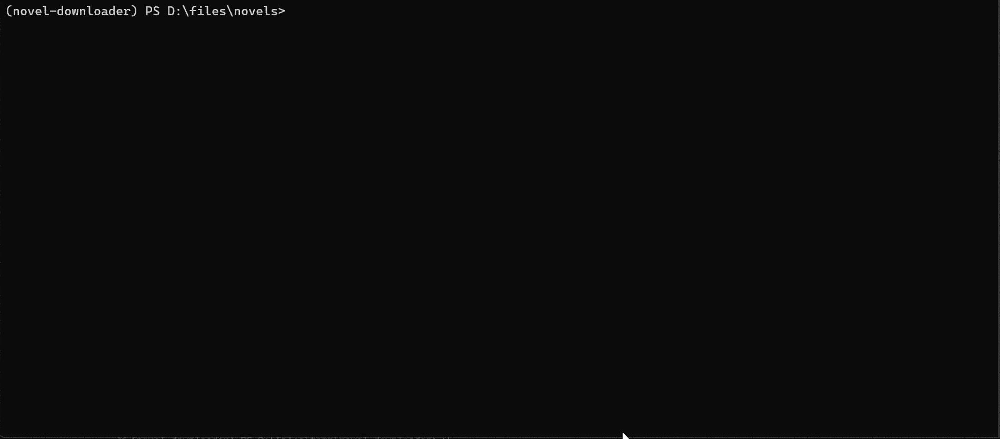

## CLI Usage Examples

For the list of supported sites, see: [Supported Sites documentation](../supported-sites/index.md)

### Quick Start

```bash
# Download a book from a URL
novel-cli download https://www.hetushu.com/book/5763/index.html

# Download from a specified site (e.g. b520)
novel-cli download --site b520 8_8187

# Export to EPUB
novel-cli export --format epub 88888
```

---

### Login / Authentication

When `login_required: true` is enabled in the configuration, the CLI checks the login status; if not logged in, it prompts you to enter a valid Cookie or account information for the current site on the command line.

Some sites require a logged-in session for search/download (for example fanqienovel). Besides pasting cookies by hand, the downloader can open a real browser window for you to sign in, then capture and save the session cookies automatically:

```bash
# Open a login window; cookies are saved to <cache_dir>/<site>/ on success
novel-cli login fanqienovel

# List sites that support an interactive login
novel-cli login --list
```

---

### Global Usage and Help

```text
novel-cli [-h] [-v] [--lang LANG] COMMAND [ARGS]...

Options:
  -h, --help     show this help message and exit
  -v, --version  show program's version number and exit
  --lang LANG    override the interface language for this run (e.g. en, zh); place before the subcommand
```

> All subcommands support `--help` to view their respective help text.

---

### Subcommand Overview

```text
Commands:
  download    download a novel by book ID or URL
  search      search for books across one or more sites
  browse      browse a site's rankings and categories
  follow      follow books and check for new chapters
  export      export downloaded novels
  login       open a login window for a site and save its session cookies
  config      manage application configuration and settings
  clean       clean application logs, cache and book data
  storage     show disk usage of the application's data directories
  doctor      check the environment and diagnose common problems
  sources     list, verify, install and remove rule-based book sources
  music       search and download songs from music platforms
  completion  print a shell completion script for novel-cli
  batch       batch search a 'title author' list and optionally download the matches
  update      check for a newer release and optionally download it
```

There are 15 subcommands in total. `batch` and `update` are appended by the entry point, so they appear after `completion`.

---

#### 1. download Subcommand

Download a complete novel, supporting three approaches:

1. **Pass the URL directly**
2. **Specify site + book ID**
3. **Omit arguments, read the ID from the configuration file**

**Synopsis**

```bash
novel-cli download [-h] [--site SITE] [--config CONFIG] [--start START] [--end END] [--no-export] [--format FORMAT [FORMAT ...]] [--json] [--strict] [book_ids ...]
```

**Options**

* `book_ids | url`:
    * Enter a book ID (used together with `--site`)
    * Enter a book/chapter URL (the site and book ID are resolved automatically)
    * When omitted, `book_ids` is read from the configuration file
* `--site SITE`: site key (e.g. `qidian`, `b520`, ...); can be omitted if a URL is passed directly
* `--start START`: start chapter **unique ID** (only applied to the first `book_id`)
* `--end`: end chapter **unique ID**, **inclusive** (only applied to the first `book_id`)
* `--no-export`: download only, no export. When enabled, the export step is skipped
* `--format FORMAT [FORMAT ...]`: export format: `txt` / `epub` / `html`; multiple values allowed; defaults to the setting in the configuration file
* `--json`: print the result to stdout as JSON and exit (structure in the table at the end of this page)
* `--strict`: exit non-zero if any chapter could not be downloaded; an incomplete book is not exported, and up to 20 failures are listed (the default only warns with the first 5)

> `--start` / `--end` are used to temporarily download a subset of chapters, and only affect the **first** `book_id` provided on the command line.
>
> `--start` and `--end` accept a **chapter unique ID**, not the "N-th chapter" ordinal.
>
> For complex ranges/ignoring chapters, etc., use structured `book_ids` in the configuration file; see [Configuration File Reference](./settings-reference.md).

**Examples**


```bash
# Approach 1: start the download directly via URL
novel-cli download https://www.hetushu.com/book/5763/index.html

# Approach 2: specify site + book ID
novel-cli download --site b520 8_8187
novel-cli download --site n23qb 12282
novel-cli download --site qidian 1010868264

# Download only some chapters
novel-cli download --site qidian 1010868264 --start 402902546 --end 406807540

# Download only, skip the export step
novel-cli download --no-export --site qidian 1010868264

# Approach 3: read the ID from the configuration file
novel-cli download --site n23qb
```

---

#### 2. search Subcommand

Search for novels by keyword

**Synopsis**

```bash
novel-cli search [-h] [--site SITE] [--config CONFIG] [--limit N] [--site-limit M] [--timeout SECS] [--format FORMAT [FORMAT ...]] [--json] [--first] [--sort {quality,priority,site,title,author,words,update}] [--group | --no-group] keyword
```

**Options**

* `keyword`: search keyword
* `--site SITE`, `-s SITE`: specify the search site; can be used multiple times to specify multiple sites; if not specified, all supported sites are searched
* `--limit N`, `-l N`: overall result limit (minimum 1), defaults to **no limit**
* `--site-limit M`: per-site result limit (minimum 1), defaults to `10`
* `--timeout SECS`: wall-clock budget per site in seconds, defaults to `5.0`; a site that misses it is dropped, and the whole search returns at roughly that budget
* `--format FORMAT [FORMAT ...]`: export format used when auto-downloading a confirmed result (defaults to the config file)
* `--json`: print all search results to stdout as JSON and exit (for scripts)
* `--first`: download the top-ranked result directly without confirmation (non-interactive)
* `--sort {quality,priority,site,title,author,words,update}`: result ordering, defaults to `quality`
* `--group` / `--no-group`: merge the same book across sites into one row, with the `site` column listing every source (`*` marks the best source). Default: no grouping (`--no-group`).
* A keyword may be a two-to-four-token "title + author" query: spaces (including the full-width space), `·`, `,`, `，` and `-` split it into tokens matched against the title and author separately, while the whole keyword still participates in the score. For example, `"斗破苍穹 天蚕土豆"`. Multi-token matching only affects ranking and does **not** change the cache key.

**Examples**



```bash
# Search all sites (all by default)
novel-cli search 三体

# Specify a single site (e.g. b520)
novel-cli search --site b520 三体

# Search b520, returning at most 5 results
novel-cli search --site b520 --limit 5 三体

# Return at most 20 overall, at most 5 per site
novel-cli search --limit 20 --site-limit 5 三体

# Specify multiple sites (b520 and n23qb)
novel-cli search -s b520 -s n23qb 三体

# Search title + author together: the two tokens match title and author separately
novel-cli search "斗破苍穹 天蚕土豆"
```

!!! note "Why fanqienovel is excluded from aggregate searches"
    Fanqie signs its search requests client-side, and needs **no login**. Selecting the site explicitly uses the official app API: the first run registers a device identity (cached on disk), after which `x-argus` / `x-gorgon` / `x-ladon` are computed locally — no browser window involved.

    ```bash
    novel-cli search -s fanqienovel 斗破苍穹
    ```

    Aggregate searches still skip Fanqie to keep the "fast, no window" contract; browser-assisted search remains only as a fallback when the app API is unavailable (and needs the optional browser component).

---

#### 2.1 browse Subcommand

Browse a site's own rankings and category tree without a keyword (fanqienovel today)

**Synopsis**

```bash
novel-cli browse [-h] [--categories] [--category ID|NAME] [--gender {1,2,female,male}] [--limit N] [--config CONFIG] [--json] [--first] site
```

**Options**

* `site`: site key (e.g. `fanqienovel`)
* `--categories`: list the site's categories, grouped by audience, and exit
* `--category ID|NAME`: list the books of one category, by id or name; a name shared by both audiences follows `--gender`
* `--gender {male,female,1,2}`: audience used for category browsing, defaults to `male`
* `--limit N`: number of entries to show, defaults to `20`
* `--json`: print the entries as JSON and exit
* `--first`: download the top entry without asking after selection (non-interactive)

**Examples**

```bash
# What categories exist?
novel-cli browse fanqienovel --categories

# Top 10 of the ranking page
novel-cli browse fanqienovel --limit 10

# Pick a category by name (no id needed)
novel-cli browse fanqienovel --category 西方奇幻 --limit 20

# Machine-readable output
novel-cli browse fanqienovel --category 1141 --json
```

!!! note "Why fanqienovel can be browsed"
    The category tree lives in the ranking page's `window.__INITIAL_STATE__.rankCategoryTypeList` (19 male + 18 female), and the books come from `/api/library/book_list`, which needs no signature as long as the query carries `word_count=0&sort=0`.

---

#### 3. export Subcommand

Export downloaded novels to a specified format

**Synopsis**

```bash
novel-cli export [-h] [--format FORMAT [FORMAT ...]] [--site SITE] [--config CONFIG] [--start START] [--end END] [--stage STAGE] [--json] [book_ids ...]
```

**Options**

* `book_ids`: one or more book IDs to export (optional; if omitted, you will be prompted to select interactively)
* `--format FORMAT [FORMAT ...]`: export format: `txt` / `epub` / `html`; multiple values allowed; defaults to the setting in the configuration file
* `--site SITE`: site key (e.g. `b520`, `qidian`, ...), (optional; if omitted, you will be prompted to select interactively)
* `--config CONFIG`: specify the configuration file path (optional)
* `--start START`: start chapter ID, applied only to the first book
* `--end END`: end chapter ID, applied only to the first book
* `--stage STAGE`: export stage (e.g. `raw`, `cleaner`); defaults to the last stage
* `--json`: print the result to stdout as JSON and exit (structure in the table at the end of this page)

**Examples**


```bash
# Specify the export format as EPUB
novel-cli export --format epub

# Specify the source site and export multiple books
novel-cli export --site b520 12345 23456

# Omit site and book_ids to enter interactive mode for selecting the site and books
novel-cli export
```

> Tip: When `--site` or `book_id` is not specified, you enter interactive mode to choose from sites and books that have already been downloaded.

---

#### 4. config Subcommand

Initialize and manage downloader settings, including switching languages, etc.

**Synopsis**

```bash
novel-cli config COMMAND [ARGS]...
```

**Subcommands**

* `init [--force]`: initialize the default configuration file in the current directory (`./settings.toml`); `--force` overwrites an existing file
* `set-lang LANG`: switch the CLI language (`zh_CN` / `en_US`)

**Examples**

```bash
# Switch the interface language to English
novel-cli config set-lang en_US

# Initialize the default configuration in the current directory
novel-cli config init

# Forcefully overwrite an existing configuration file
novel-cli config init --force
```

---

#### 5. clean Subcommand

Used to clean up the **internal state / logs / site cache / raw book data** generated while the application runs.

After cleaning, the corresponding resources are automatically regenerated on the next run (e.g. re-crawling metadata / chapters / media, etc.).

`clean` contains 4 subcommands:

* `state`: clean up internal state files (runtime state, temporary information)
* `logs`: clean up application log files
* `cache`: clean up site-level cache (fonts/shared resources, etc., organized by site directory)
* `book`: clean up raw book cache data (chapter SQLite / metadata / media / or the entire book directory)

**Synopsis**

```bash
novel-cli clean [-h] {state,logs,cache,book} ...
```

**Examples**

```bash
# View the overall help for clean
novel-cli clean --help
```

---

#### 5.1 clean state Subcommand

Clean up internal state files (e.g. runtime records, temporary information)

**Synopsis**

```bash
novel-cli clean state [-h] [-y]
```

**Options**

* `-y, --yes`: skip the confirmation prompt and execute directly

**Examples**

```bash
# Clean up internal state
novel-cli clean state

# Force clean (skip confirmation)
novel-cli clean state --yes
```

---

#### 5.2 clean logs Subcommand

Clean up the log files generated by the application.

**Synopsis**

```bash
novel-cli clean logs [-h] [--config CONFIG] [-y] [--dry-run]
```

**Options**

* `--config CONFIG`: configuration file path
* `-y, --yes`: skip the confirmation prompt
* `--dry-run`: only show the log files that will be deleted, without actually deleting them

**Examples**

```bash
# Dry run: view the log files that will be deleted
novel-cli clean logs --dry-run

# Clean up logs
novel-cli clean logs

# Force clean logs (skip confirmation)
novel-cli clean logs -y

# Specify the configuration file location
novel-cli clean logs --config ./settings.toml
```

---

#### 5.3 clean cache Subcommand

Clean up the site-level cache directory. The cache directory structure is:

```
<cache_dir>/<site_key>/
```

For example, fonts shared across a site or parsing cache, etc.

**Synopsis**

```bash
novel-cli clean cache [-h] [--config CONFIG] [--site SITE] [-y]
```

**Options**

* `--config CONFIG`: configuration file path
* `--site SITE`: site key (e.g. `qidian`, `b520`); when omitted, the cache of all sites is cleaned.
  The value is joined onto the cache root and then deleted, so it must be a
  **single directory name**: `..`, `../..`, `/etc`, values containing `/`, `\`,
  `:`, or control characters exit with a usage error (`2`) and never touch
  anything outside the cache root
* `-y, --yes`: skip the confirmation prompt

**Examples**

```bash
# Clean up the cache of a specified site
novel-cli clean cache --site qidian

# Clean up the cache of all sites (delete the entire cache_dir)
novel-cli clean cache

# Skip the confirmation prompt
novel-cli clean cache --site b520 -y

# Specify the configuration file
novel-cli clean cache --config ./settings.toml
```

---

#### 5.4 clean book Subcommand

Clean up the raw cache data of one or more books. The data directory structure is:

```
<raw_data_dir>/<site_key>/<book_id>/
```

By default, chapter SQLite data is deleted (the range can be limited via `--start/--end`)

You can optionally specify whether to delete media or the entire book directory.

**Synopsis**

```bash
novel-cli clean book [-h]
    [--site SITE] [--config CONFIG]
    [--start START] [--end END]
    [--stage STAGE]
    [--no-chapters] [--metadata] [--media] [--all]
    [-y]
    [book_ids ...]
```

**Options**

* `book_ids`: one or more book IDs
* `--site SITE`: site key (same rule as `clean cache --site`: one directory
  name only; `..`, path separators, drive letters, and similar escapes exit
  with `2`)
* `--config CONFIG`: configuration file path
* `--start START`: start chapter ID (only effective for the first book)
* `--end END`: end chapter ID (only effective for the first book, **inclusive of end**)
* `--stage STAGE`: cleaning stage (e.g. `raw`, `cleaner`), defaults to `raw`
* `--no-chapters`: do not delete chapter data (SQLite is left untouched)
* `--metadata`: delete metadata JSON
* `--media`: delete the media resource directory (images, etc.)
* `--all`: delete **all raw data directories** of the book (ignoring other cleaning options); if `book_ids` is also omitted, clean the entire raw_data of the specified site / all sites
* `-y, --yes`: skip the confirmation prompt

**Examples**

```bash
# Default clean
novel-cli clean book --site qidian 1010868264

# Clean a specified range of chapters (only effective for the first book)
novel-cli clean book --site qidian 1010868264 --start 402902546 --end 406807540

# Clean only metadata, not chapters
novel-cli clean book --site qidian 1010868264 --no-chapters --metadata

# Clean media (images, etc.)
novel-cli clean book --site qidian 1010868264 --media

# Delete all raw data of the entire book (delete the directory directly)
novel-cli clean book --site qidian 1010868264 --all

# Delete all raw_data of a specified site (omit book_ids and use --all)
novel-cli clean book --site qidian --all

# Delete all raw_data of all sites (omit site and use --all)
novel-cli clean book --all

# Skip the confirmation prompt
novel-cli clean book --site qidian 1010868264 --all -y
```

> Tip: `--start/--end` accept a **chapter unique ID**, not the "N-th chapter" ordinal

---

#### 6. login Subcommand

Open a real browser window for a site that requires a login, then save the session cookies automatically for later search/download.

The optional graphical interface components are required; otherwise the command tells you to install them.

**Synopsis**

```bash
novel-cli login [-h] [--timeout SECONDS] [--list] [site]
```

**Options**

* `site`: Site key, defaults to `fanqienovel`
* `--timeout SECONDS`: Seconds to wait for the login to complete, defaults to `300`
* `--list`: List sites that support an interactive login

**Examples**

```bash
# Log in to fanqienovel and save the cookies
novel-cli login fanqienovel

# Custom wait time (seconds)
novel-cli login fanqienovel --timeout 600

# List sites that support an interactive login
novel-cli login --list
```

> Saved to: `<cache_dir>/<site>/aiohttp.cookies`
>
> If the window is closed without a detected session the command exits non-zero and saves nothing.

---

#### 7. music Subcommand

Search and download songs from multiple music platforms. This feature depends on the optional `music` group; when it is missing, the command prints an installation hint:

```bash
pip install "novel-downloader[music]"
```

`music` has five subcommands: `platforms`, `search`, `download`, `export-m3u`, and `health`.

**Synopsis**

```bash
novel-cli music [-h] {platforms,search,download,export-m3u,health} ...

novel-cli music platforms

novel-cli music search [-h] [--platform KEY] [--limit N] [--json] keyword

novel-cli music download [-h] [--keyword KEYWORD] [--platform KEY] [--limit N]
                         [--level {hires,lossless,exhigh,higher,standard}]
                         [--out DIR] [--pick N[,N|ID]] [--yes]
                         [KEYWORD]

novel-cli music export-m3u [-h] --keyword KEYWORD [--platform KEY] [--limit N]
                           [--out FILE]

novel-cli music health [-h] [--platform KEY] [--keyword KEYWORD]
```

**General Options**

* `--platform KEY`: music platform key. `search` and `download` default to `all` (aggregate search across every platform, merging the same song into one row with its sources); a concrete key still works. `export-m3u` defaults to `netease`. Run `novel-cli music platforms` for the full list
* `--limit N`, `-l N`: maximum number of results, defaults to `20`

**platforms**

List the available music platforms with their notes:

```bash
novel-cli music platforms
```

**search**

Search songs by keyword; every platform is searched by default. The result table shows index, title, artist, album, duration and VIP; the all-platform mode adds a sources column:

```bash
# Search every platform (default)
novel-cli music search "keyword" --limit 10

# Search NetEase only
novel-cli music search "keyword" --platform netease --limit 10
```

* `--json`: print the search results as JSON (`platform`, `keyword`, `total`, and a `tracks` list) and exit, for script consumption; in aggregate mode each track also carries `sources` and the response includes a `platforms` summary

```bash
novel-cli music search "keyword" --json
```

**download**

Search first, then select and download songs:

* Positional `KEYWORD` or `--keyword KEYWORD`: keyword to search for before downloading (use one of them)
* `--level`: audio quality level, one of `hires` / `lossless` / `exhigh` / `higher` / `standard`; defaults to the music setting, usually `exhigh`
* `--out DIR`: output directory; defaults to the music setting (falling back to the default download directory)
* `--pick N[,N|ID]`: download the given search result index/indices (1-based) or song ID(s) without prompting
* `--yes`: download every search result without prompting

When neither `--pick` nor `--yes` is given and the terminal is interactive, a paged selector appears (enter numbers, `a` for all, `n` next, `p` previous, Enter to cancel). In a non-interactive environment you must pass `--pick` or `--yes`.

**export-m3u**

Write the search results that have **already been downloaded** to an M3U playlist; no audio is downloaded. Only tracks with a local file path are written, those without one are skipped, and the command fails when none can be written:

* `--keyword KEYWORD, -k KEYWORD` (required): keyword used to search for the songs to add
* `--out FILE`: playlist path, defaults to `<output directory>/<keyword>.m3u8`

```bash
novel-cli music export-m3u --keyword "keyword" --platform netease --limit 10
```

**health**

Run one bounded search per platform (1 result is enough) to check whether it can be reached; useful for troubleshooting network or platform problems. A search that succeeds but returns zero results still counts as healthy (for example, an auth-gated platform without configured credentials):

* `--platform KEY`: check only the given platform; omit it to check every platform
* `--keyword KEYWORD`: keyword used for the connectivity probe, defaults to `test`

```bash
# Check every platform
novel-cli music health

# Check NetEase only
novel-cli music health --platform netease
```

**Examples**

```bash
# List available platforms
novel-cli music platforms

# Search every platform (default)
novel-cli music search "keyword"

# Search NetEase only
novel-cli music search "keyword" --platform netease

# Search on QQ Music and output JSON
novel-cli music search "keyword" --platform qq --json

# Download the first search result
novel-cli music download "keyword" --pick 1

# Download results 1 and 3 with hi-res quality into a custom directory
novel-cli music download "keyword" --pick 1,3 --level hires --out ./music

# Download every search result without confirmation
novel-cli music download "keyword" --yes

# Download by a song ID present in the search results
novel-cli music download "keyword" --pick 123456789
```

> Progress display, tag embedding, cover and lyric saving, folder splitting, and skip-existing behavior follow the music settings (`embed_tags`, `embed_cover`, `save_lyric`, `split_folder`, `skip_existing`).

---

#### 8. follow Subcommand

Maintain a follow list and check whether followed books have published new chapters.

Follow entries live in `watchlist.json` inside the application home directory (`NOVEL_HOME`; by default `%LOCALAPPDATA%\novel_downloader\watchlist.json` on Windows). They are independent of `book_ids` in `settings.toml`.

**Synopsis**

```bash
novel-cli follow [-h] {add,remove,list,check} ...

novel-cli follow add [-h] [--title TEXT] site book_id
novel-cli follow remove [-h] site book_id
novel-cli follow list [-h] [--json]
novel-cli follow check [-h] [--all] [--download] [--wait]
                       [--wait-timeout SECS] [--timeout SECS]
```

**add / remove**

* `site`: site key (e.g. `b520`, `qidian`)
* `book_id`: book ID
* `--title TEXT` (add only): display title used when checking for new chapters. If omitted, `follow check` can only search by `book_id`, which is much less reliable; always provide a title.

```bash
# Add a book to the follow list
novel-cli follow add b520 8_8187 --title "Example Novel"

# Adding an existing book updates it (recorded latest chapter is preserved)
novel-cli follow add b520 8_8187 --title "Example Novel (renamed)"

# Remove
novel-cli follow remove b520 8_8187
```

**list**

```bash
# Table output: site / book ID / title / latest chapter / updated
novel-cli follow list

# Machine-readable output (JSON array)
novel-cli follow list --json
```

Each `--json` element contains `site`, `book_id`, `title`, `last_chapter`, and `updated_at`.

**check**

* `--all`: also show books that are up to date or could not be found; without it only new chapters and errors are reported.
* `--download`: print an executable `novel-cli download ...` command for each book with new chapters.
* `--wait`: used with `--download`, actually download: queue each new-chapter book in the task manager and wait for it to finish before starting the next one.
* `--wait-timeout SECS`: max seconds to wait for each download, default `1800`; only effective with `--wait`.
* `--timeout SECS`: search timeout per book, default `5.0` seconds.

```bash
# Check and report new chapters only
novel-cli follow check

# Show the status of every followed book
novel-cli follow check --all

# Also print download commands for books with new chapters
novel-cli follow check --download

# Automatically download books with new chapters, one at a time
# (each book waits up to the default 1800 seconds)
novel-cli follow check --download --wait

# Custom per-download wait limit (e.g. one hour)
novel-cli follow check --download --wait --wait-timeout 3600
```

By default `check` performs searches only and **never starts a download**: downloads are long-running and the CLI has no background scheduler, so it prints the command instead, keeping the command fast, non-blocking, and predictable. To download automatically you have two options: hand the printed `novel-cli download --site <site> <book_id>` to a scheduled task (see [Common Recipes](./recipes.md)), or use `follow check --download --wait` and let the CLI download the books itself, one by one.

Semantics of `--wait`:

* **One book at a time**: books with new chapters are queued and downloaded sequentially; the next book starts only after the current one finishes (completed/failed/cancelled), so no site is hit with concurrent pressure.
* **Timeout counts as cancelled**: `--wait-timeout` bounds the wait for a single book; a task whose budget expires is cancelled and reported as "cancelled" in the summary, while the remaining books still get their own full wait budget.
* **Summary output**: after everything finishes, a summary like `Download summary: X completed, Y cancelled, Z failed.` is printed.
* **Exit code**: `0` is returned only when no check failed and every download completed; any failed check, or any download that failed/was cancelled/timed out, ends the command with `1`.
* `--wait` requires `--download`; on its own it is a usage error (exit code `2`).

> The first check of a book only records the current latest chapter (reported as `First chapter recorded ...`), so it is not mistaken for an update.
>
> If any book's check fails (network/plugin error), the command exits with code `1` even when the other books succeeded.

---

#### 9. storage Subcommand

Report the disk usage of the four application data directories, and optionally clean them all:

| Category | Directory source |
| --- | --- |
| Raw data | `general.raw_data_dir` |
| Cache | `general.cache_dir` |
| Downloads | `general.output_dir` |
| Logs | `general.debug.log_dir` |

**Synopsis**

```bash
novel-cli storage [-h] [--json] [--clean] [-y]
```

**Options**

* `--json`: print the statistics as JSON on stdout and exit.
* `--clean`: print the table, then remove the existing data directories listed above (bulk equivalent of cleaning raw/cache/downloads/logs).
* `-y, --yes`: skip the confirmation prompt used by `--clean`.
* `--json` and `--clean` cannot be combined (exit code `2`).

**Examples**

```bash
# Show usage
novel-cli storage

# Machine-readable output
novel-cli storage --json

# Remove all data directories (asks for confirmation)
novel-cli storage --clean

# Skip confirmation (for scripts/scheduled tasks)
novel-cli storage --clean -y
```

The `--json` shape is `{ "raw": {...}, "cache": {...}, "downloads": {...}, "logs": {...}, "total": {...} }`; each directory object has `label`, `path`, `files`, and `bytes`, while `total` has only `files` and `bytes`.

---

#### 10. doctor Subcommand

Run a set of **offline** self-checks to diagnose environment problems quickly.

**Synopsis**

```bash
novel-cli doctor [-h] [--port N] [--json] [--online]
```

**Checks**

* Python version is >= 3.11
* Installed package version
* `settings.toml` / `settings.json` is found
* The configuration parses as a root table
* The output directory can be created and written (the directory is created and a temporary file is written/removed)
* Number of registered download sites
* Number of loadable searchers
* Optional music dependencies (`mutagen`, `qrcode`, `websocket`) — missing ones are reported but do not fail the command
* `127.0.0.1:<port>` can be bound (default 8081)

**Options**

* `--port N`: API port to check for availability, default `8081`.
* `--json`: print the check results (`summary` + `checks`) to stdout as JSON and exit.
* `--online`: additionally probe network egress (`https://www.baidu.com` and `https://github.com`, 2.5 s timeout each); the probe is advisory and never makes the command exit non-zero.

**Examples**

```bash
# Default checks
novel-cli doctor

# Check a custom API port
novel-cli doctor --port 9000
```

> Exit code is `0` when every required check passes and `1` otherwise. Each failing row prints an actionable fix.

---

#### 11. completion Subcommand

Print a shell completion script for `novel-cli`. The completion is generated from the command tree as a flat word list (subcommand and option names, no option values), so new subcommands appear automatically without maintaining the script by hand.

**Synopsis**

```bash
novel-cli completion [-h] [--shell {bash,zsh,powershell}]
```

**Options**

* `--shell {bash,zsh,powershell}`: shell to generate the script for; when omitted it is auto-detected: `$SHELL` pointing to bash/zsh is honored, otherwise Windows defaults to `powershell` and other platforms to `bash`.

**Examples**

```bash
# Bash: takes effect in the current session; persist by adding it to ~/.bashrc
source <(novel-cli completion --shell bash)

# Zsh: the script carries its own #compdef declaration, so source it in an
# interactive session that has completion enabled
source <(novel-cli completion --shell zsh)

# Zsh (persistent): drop it into a directory on $fpath, the file must be named _novel-cli
novel-cli completion --shell zsh > "${fpath[1]}/_novel-cli"
```

```powershell
# PowerShell: append to $PROFILE to register the completer at every startup
novel-cli completion --shell powershell >> $PROFILE
```

---

#### 12. batch Subcommand

Search a plain-text reading list in one pass, optionally downloading and exporting the matches. One book per line:

* `title author`: separated by any run of whitespace (spaces, tabs, the full-width space); a line with a single field is matched by title (with a warning).
* When the title itself contains spaces, separate title and author with a **Tab** (`title<TAB>author`); spaces before the first Tab stay part of the title.
* Lines starting with `#` are comments and blank lines are ignored. Lines that cannot be parsed are not dropped silently: they are reported and preserved as comments in the not-found file.

**Synopsis**

```bash
novel-cli batch [-h] (--file PATH | --from-not-found PATH) [--site SITE]
                [--out DIR] [--strict-match] [--not-found PATH] [--force]
                [--download] [--interval SECONDS] [--verbose] [--config CONFIG]
```

**Options**

* `--file PATH`: read `title author` lines from PATH (mutually exclusive with `--from-not-found`; one is required)
* `--from-not-found PATH`: continue from a not-found file written by a previous `batch` run
* `--site SITE`: search only this site; omit it to search every site. `--from-not-found` reuses the site recorded in the file's `# site=` header (not when it is recorded as `all`)
* `--out DIR`: write exported books to DIR and the raw cache to `DIR/raw_data`; defaults to the configuration
* `--strict-match`: require both title and author to match exactly; the default matches the title exactly and picks the most similar author
* `--not-found PATH`: where to write unmatched entries; defaults to `logs/not_found_<site>.txt`
* `--force`: overwrite an existing `--not-found` file that was not written by this command
* `--download`: download and export the matched books; the default only reports the matches
* `--interval SECONDS`: seconds to wait between book searches, default `0`
* `--verbose`: show candidate counts and author-match details
* `--config CONFIG`: configuration file path

**Not-found file and retrying on another site**

The not-found file keeps the exact input format: its first line is `# site=<site> searched_at=<time> matches=<matched>/<total>`, and it ends with a `#` marker, so it can be fed straight back into `batch --from-not-found`. A typical switch-site workflow:

```bash
# 1. Search every site and download
novel-cli batch --file books.txt --download

# 2. Some books were not found; retry them on another site (an explicit --site overrides the recorded one)
novel-cli batch --from-not-found logs/not_found_all.txt --site biquge5r --download

# 3. Omit --site to reuse the site recorded in the file header
novel-cli batch --from-not-found logs/not_found_b520.txt --download
```

> Without `--download` the command only reports matches. `--file` input is always read-only: even `--force` never writes the not-found result back into the input file.

**Examples**

```bash
# books.txt holds one "title author" pair per line
novel-cli batch --file books.txt
novel-cli batch --file books.txt --site b520 --download
novel-cli batch --file books.txt --download --interval 1.5 --verbose
```

---

#### 13. update Subcommand

Check the update manifest (`latest.json`) and optionally download this platform's asset. Checking and downloading are two separate steps: `--check` only checks, and the download must be triggered explicitly. The CLI only **downloads and verifies**; it never executes, unpacks or installs anything.

**Synopsis**

```bash
novel-cli update [-h] [--check] [--json] [-y] [--no-mirror]
```

**Options**

* `--check`: check only; never ask or download. The exit code reports whether the *check* worked, not whether an update exists
* `--json`: print one machine-readable JSON document on stdout and exit; without `--yes` it behaves like `--check` and leaves `download_path` as `null`
* `-y, --yes`: non-interactive download; downloads, verifies the SHA-256 digest and prints the file path, but does **not** install it. An asset without a digest is refused
* `--no-mirror`: ignore `NOVEL_UPDATE_MIRROR` and download from the release URL directly

**Security constraints**:

* The asset URL in the manifest must be `https://`; a plaintext address is
  refused before prompting or downloading and exits with code `1` (`error` is
  `insecure-url` with `--json --yes`).
* An asset without a SHA-256 digest is never downloaded (`missing-digest`); the
  digest is verified before the file path is printed.
* One asset is capped at `1 GiB`; if an HTTPS request is redirected to plain
  HTTP, the download is refused.
* On failure: a non-resume transfer deletes `.part` before the next retry; a
  resumable transfer keeps the downloaded prefix; a digest mismatch always
  deletes `.part`. If every retry fails, the unfinished file may remain in
  `updates/` and the desktop app removes it after 1 day. See section 13 of
  [Troubleshooting](./troubleshooting.en.md) for the full diagnosis.

**Environment variable**

* `NOVEL_UPDATE_MIRROR`: comma-separated mirror prefixes, probed in order and used when one answers; when none answers the original release URL is used, and an unset variable means no mirror.

The file always lands in `<app home>/updates/` (never the current directory). To install: on Windows double-click the downloaded `NovelDownloader-setup-<version>-x64.exe`; on other platforms extract the archive and replace the installed files manually. See [Updates and auto-update](./updates.en.md) for the desktop/Android automatic checks and the full verification rules.

**Examples**

```bash
# Check only
novel-cli update --check

# Check, then ask before downloading
novel-cli update

# Scripted: download and verify without installing
novel-cli update --yes

# Machine-readable output
novel-cli update --json
```

---

### Exit Codes and `--json` Contract

#### Exit codes

| Code | Meaning | Typical cases |
| --- | --- | --- |
| `0` | Success | The command completed; no search results or no new chapters is still success |
| `1` | Runtime failure | Network/site error, login failure, unparsable configuration, incomplete download/export, any failed follow check, a follow `--wait` download that did not succeed, a required `doctor` check failing, a failed structural `sources list --check`, a failed removal in `storage --clean` / `clean`, unmatched/malformed/download-failed entries in `batch`, a failed `update` check (also no asset for the platform, missing digest, or a failed download with `--yes`) |
| `2` | Usage error | Missing/conflicting arguments (including argparse errors), `--json` with `--first`, `--json` with `--clean`, no URL/book ID, unsupported `config set-lang` language, `music` without a keyword or without `--pick`/`--yes` in a non-interactive shell, `batch` without an input file or with a negative `--interval`, `clean --site` given a traversal value such as `..` or a path separator |

The `update --check` exit code reports whether the **check** succeeded, not whether an update exists: finding one still returns `0`. `sources list --probe` never changes the exit code by itself — network unreachability only shows as `-` in the `Latency`/`HTTP` columns, and only a failed structural `--check` exits with `1`.

Pressing `Ctrl+C` prints `Aborted.` on stderr and exits with `1`.

#### `--json`

With `--json`:

* Structured output goes **only** to stdout; logs, progress, errors, and hints go to stderr, so the output can be piped safely.
* The command never enters an interactive selector; required arguments must be supplied explicitly.
* A JSON summary may still be printed even when the final exit code is non-zero (for example, `download --json` when some books fail).

| Command | Option | stdout shape |
| --- | --- | --- |
| `download` | `--json` | `{"site": ..., "books": [{"book_id", "downloaded", "failed", "exported"}]}`; `failed` is the number of missing chapters (`0` means complete); `exported` is `{format: [paths...]}`, or `null` with `--no-export` |
| `search` | `--json` | Array of results with `site`, `book_id`, `book_url`, `cover_url`, `title`, `author`, `latest_chapter`, `update_date`, `word_count`, `priority`, plus the read-only derived fields `rank_score` (`0..1`) and `match_tier` (`0..4`: `4` exact / `3` prefix / `2` contains / `1` partial / `0` no match) |
| `export` | `--json` | `{"site": ..., "books": [{"book_id", "exported"}]}` |
| `sources list` | `--json` | Array with `site_key`, `name`, `search`, `hosts`, `origin`; `status` is populated only with `--check` (otherwise `null`); with `--probe` each item also carries `latency_ms` and `http_status` (`null` when unreachable) |
| `update` | `--json` | One object with exactly eight keys: `current`, `latest`, `available`, `asset_name`, `asset_size`, `sha256`, `download_path`, `error`; absent values are `null` (or an empty string for `latest`) |
| `music search` | `--json` | `{"platform", "keyword", "total", "tracks": [...]}`; with `platform=all` (the default) each track carries `sources` and the response also includes a `platforms` summary |
| `follow list` | `--json` | Array with `site`, `book_id`, `title`, `last_chapter`, `updated_at` |
| `storage` | `--json` | `{"raw", "cache", "downloads", "logs", "total"}` |

```bash
# Typical script use: take the first book ID
novel-cli search --site b520 --json "Three Body" | jq -r '.[0].book_id'

# Count follow-list entries
novel-cli follow list --json | jq 'length'

# Read the total bytes used
novel-cli storage --json | jq '.total.bytes'
```

> `login --list` prints a plain-text list, not JSON. `sources check`, `config`, `clean`, and `batch` currently have no `--json`.
>
> The `jq` examples above require [jq](https://jqlang.github.io/jq/); without it, read the raw JSON output directly.

---

### Appendix A: Terminology and Conventions

* **SITE (site key)**: A short name used in commands to designate a site (e.g. `qidian`, `b520`, `n23qb`).
* **Chapter unique ID**: The ID used by the site to identify a chapter; it is **not** a sequential "Chapter N" ordinal; this ID should be passed to `--start`/`--end`.
* **Configuration file path**: If `--config` is not explicitly passed, the CLI resolves it automatically according to the "configuration priority".
