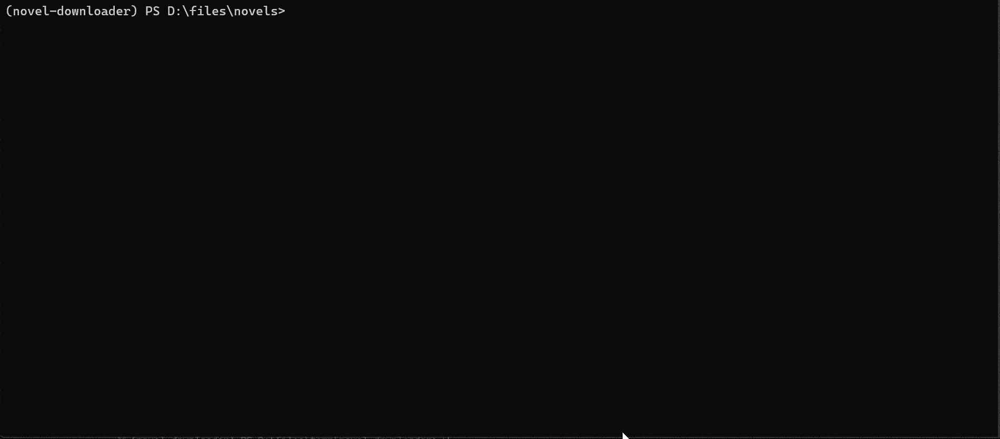

## CLI Usage Examples

For the list of supported sites, see: [Supported Sites documentation](../supported-sites/index.md)

### Quick Start

```bash
# Download a book from a URL
novel-cli download https://www.hetushu.com/book/5763/index.html

# Download from a specified site (e.g. b520)
novel-cli download --site b520 8_8187

# Export to EPUB
novel-cli export --format epub 88888
```

---

### Login / Authentication

When `login_required: true` is enabled in the configuration, the CLI checks the login status; if not logged in, it prompts you to enter a valid Cookie or account information for the current site on the command line.

Some sites require a logged-in session for search/download (for example fanqienovel). Besides pasting cookies by hand, the downloader can open a real browser window for you to sign in, then capture and save the session cookies automatically:

```bash
# Open a login window; cookies are saved to <cache_dir>/<site>/ on success
novel-cli login fanqienovel

# List sites that support an interactive login
novel-cli login --list
```

> The Web UI search page offers the same login button; it behaves exactly like `novel-cli login`.

---

### Global Usage and Help

```text
novel-cli COMMAND [ARGS]...

Options:
  --help    显示此帮助信息并退出
```

> All subcommands support `--help` to view their respective help text.

---

### Subcommand Overview

```text
Commands:
  download    下载小说
  search      搜索小说
  export      导出已下载的小说
  login       打开站点登录窗口并保存会话 Cookies
  config      管理配置与语言
  clean       清理缓存与配置
```

---

#### 1. download Subcommand

Download a complete novel, supporting three approaches:

1. **Pass the URL directly**
2. **Specify site + book ID**
3. **Omit arguments, read the ID from the configuration file**

**Synopsis**

```bash
novel-cli download [-h] [--site SITE] [--config CONFIG] [--start START] [--end END] [--no-export] [book_ids | url]
```

**Options**

* `book_ids | url`:
    * Enter a book ID (used together with `--site`)
    * Enter a book/chapter URL (the site and book ID are resolved automatically)
    * When omitted, `book_ids` is read from the configuration file
* `--site SITE`: site key (e.g. `qidian`, `b520`, ...); can be omitted if a URL is passed directly
* `--start START`: start chapter **unique ID** (only applied to the first `book_id`)
* `--end`: end chapter **unique ID**, **inclusive** (only applied to the first `book_id`)
* `--no-export`: download only, no export. When enabled, the export step is skipped

> `--start` / `--end` are used to temporarily download a subset of chapters, and only affect the **first** `book_id` provided on the command line.
>
> `--start` and `--end` accept a **chapter unique ID**, not the "N-th chapter" ordinal.
>
> For complex ranges/ignoring chapters, etc., use structured `book_ids` in the configuration file; see [Configuration File Reference](./settings-reference.md).

**Examples**


```bash
# Approach 1: start the download directly via URL
novel-cli download https://www.hetushu.com/book/5763/index.html

# Approach 2: specify site + book ID
novel-cli download --site b520 8_8187
novel-cli download --site n23qb 12282
novel-cli download --site qidian 1010868264

# Download only some chapters
novel-cli download --site qidian 1010868264 --start 402902546 --end 406807540

# Download only, skip the export step
novel-cli download --no-export --site qidian 1010868264

# Approach 3: read the ID from the configuration file
novel-cli download --site n23qb
```

---

#### 2. search Subcommand

Search for novels by keyword

**Synopsis**

```bash
novel-cli search [-h] [--site SITE] [--config CONFIG] [--limit N] [--site-limit M] keyword
```

**Options**

* `keyword`: search keyword
* `--site SITE`, `-s SITE`: specify the search site; can be used multiple times to specify multiple sites; if not specified, all supported sites are searched
* `--limit N`: overall result limit (minimum 1), defaults to `200`
* `--site-limit M`: per-site result limit (minimum 1), defaults to `10`

**Examples**



```bash
# Search all sites (all by default)
novel-cli search 三体

# Specify a single site (e.g. b520)
novel-cli search --site b520 三体

# Search b520, returning at most 5 results
novel-cli search --site b520 --limit 5 三体

# Return at most 20 overall, at most 5 per site
novel-cli search --limit 20 --site-limit 5 三体

# Specify multiple sites (b520 and n23qb)
novel-cli search -s b520 -s n23qb 三体
```

---

#### 3. export Subcommand

Export downloaded novels to a specified format

**Synopsis**

```bash
novel-cli export [-h] [--format FORMAT] [--site SITE] [--config CONFIG] [book_id ...]
```

**Options**

* `book_ids`: one or more book IDs to export (optional; if omitted, you will be prompted to select interactively)
* `--format FORMAT`: export format: `txt` / `epub`; defaults to the setting in the configuration file
* `--site SITE`: site key (e.g. `b520`, `qidian`, ...), (optional; if omitted, you will be prompted to select interactively)
* `--config CONFIG`: specify the configuration file path (optional)
* `--start`: start chapter ID, applied only to the first book
* `--end`: end chapter ID, applied only to the first book

**Examples**


```bash
# Specify the export format as EPUB
novel-cli export --format epub

# Specify the source site and export multiple books
novel-cli export --site b520 12345 23456

# Omit site and book_ids to enter interactive mode for selecting the site and books
novel-cli export
```

> Tip: When `--site` or `book_id` is not specified, you enter interactive mode to choose from sites and books that have already been downloaded.

---

#### 4. config Subcommand

Initialize and manage downloader settings, including switching languages, etc.

**Synopsis**

```bash
novel-cli config COMMAND [ARGS]...
```

**Subcommands**

* `init [--force]`: initialize the default configuration file in the current directory (`./settings.toml`); `--force` overwrites an existing file
* `set-lang LANG`: switch the CLI language (`zh_CN` / `en_US`)

**Examples**

```bash
# Switch the interface language to English
novel-cli config set-lang en_US

# Initialize the default configuration in the current directory
novel-cli config init

# Forcefully overwrite an existing configuration file
novel-cli config init --force
```

---

#### 5. clean Subcommand

Used to clean up the **internal state / logs / site cache / raw book data** generated while the application runs.

After cleaning, the corresponding resources are automatically regenerated on the next run (e.g. re-crawling metadata / chapters / media, etc.).

`clean` contains 4 subcommands:

* `state`: clean up internal state files (runtime state, temporary information)
* `logs`: clean up application log files
* `cache`: clean up site-level cache (fonts/shared resources, etc., organized by site directory)
* `book`: clean up raw book cache data (chapter SQLite / metadata / media / or the entire book directory)

**Synopsis**

```bash
novel-cli clean [-h] {state,logs,cache,book} ...
```

**Examples**

```bash
# View the overall help for clean
novel-cli clean --help
```

---

#### 5.1 clean state Subcommand

Clean up internal state files (e.g. runtime records, temporary information)

**Synopsis**

```bash
novel-cli clean state [-h] [-y]
```

**Options**

* `-y, --yes`: skip the confirmation prompt and execute directly

**Examples**

```bash
# Clean up internal state
novel-cli clean state

# Force clean (skip confirmation)
novel-cli clean state --yes
```

---

#### 5.2 clean logs Subcommand

Clean up the log files generated by the application.

**Synopsis**

```bash
novel-cli clean logs [-h] [--config CONFIG] [-y] [--dry-run]
```

**Options**

* `--config CONFIG`: configuration file path
* `-y, --yes`: skip the confirmation prompt
* `--dry-run`: only show the log files that will be deleted, without actually deleting them

**Examples**

```bash
# Dry run: view the log files that will be deleted
novel-cli clean logs --dry-run

# Clean up logs
novel-cli clean logs

# Force clean logs (skip confirmation)
novel-cli clean logs -y

# Specify the configuration file location
novel-cli clean logs --config ./settings.toml
```

---

#### 5.3 clean cache Subcommand

Clean up the site-level cache directory. The cache directory structure is:

```
<cache_dir>/<site_key>/
```

For example, fonts shared across a site or parsing cache, etc.

**Synopsis**

```bash
novel-cli clean cache [-h] [--config CONFIG] [--site SITE] [-y]
```

**Options**

* `--config CONFIG`: configuration file path
* `--site SITE`: site key (e.g. `qidian`, `b520`); when omitted, the cache of all sites is cleaned
* `-y, --yes`: skip the confirmation prompt

**Examples**

```bash
# Clean up the cache of a specified site
novel-cli clean cache --site qidian

# Clean up the cache of all sites (delete the entire cache_dir)
novel-cli clean cache

# Skip the confirmation prompt
novel-cli clean cache --site b520 -y

# Specify the configuration file
novel-cli clean cache --config ./settings.toml
```

---

#### 5.4 clean book Subcommand

Clean up the raw cache data of one or more books. The data directory structure is:

```
<raw_data_dir>/<site_key>/<book_id>/
```

By default, chapter SQLite data is deleted (the range can be limited via `--start/--end`)

You can optionally specify whether to delete media or the entire book directory.

**Synopsis**

```bash
novel-cli clean book [-h]
    [--site SITE] [--config CONFIG]
    [--start START] [--end END]
    [--stage STAGE]
    [--no-chapters] [--metadata] [--media] [--all]
    [-y]
    [book_ids ...]
```

**Options**

* `book_ids`: one or more book IDs
* `--site SITE`: site key
* `--config CONFIG`: configuration file path
* `--start START`: start chapter ID (only effective for the first book)
* `--end END`: end chapter ID (only effective for the first book, **inclusive of end**)
* `--stage STAGE`: cleaning stage (e.g. `raw`, `cleaned`), defaults to `raw`
* `--no-chapters`: do not delete chapter data (SQLite is left untouched)
* `--metadata`: delete metadata JSON
* `--media`: delete the media resource directory (images, etc.)
* `--all`: delete **all raw data directories** of the book (ignoring other cleaning options); if `book_ids` is also omitted, clean the entire raw_data of the specified site / all sites
* `-y, --yes`: skip the confirmation prompt

**Examples**

```bash
# Default clean
novel-cli clean book --site qidian 1010868264

# Clean a specified range of chapters (only effective for the first book)
novel-cli clean book --site qidian 1010868264 --start 402902546 --end 406807540

# Clean only metadata, not chapters
novel-cli clean book --site qidian 1010868264 --no-chapters --metadata

# Clean media (images, etc.)
novel-cli clean book --site qidian 1010868264 --media

# Delete all raw data of the entire book (delete the directory directly)
novel-cli clean book --site qidian 1010868264 --all

# Delete all raw_data of a specified site (omit book_ids and use --all)
novel-cli clean book --site qidian --all

# Delete all raw_data of all sites (omit site and use --all)
novel-cli clean book --all

# Skip the confirmation prompt
novel-cli clean book --site qidian 1010868264 --all -y
```

> Tip: `--start/--end` accept a **chapter unique ID**, not the "N-th chapter" ordinal

---

#### 6. login Subcommand

Open a real browser window for a site that requires a login, then save the session cookies automatically for later search/download.

The optional `pywebview` dependency is required (the `.[desktop]` extra); otherwise the command tells you to install it.

**Synopsis**

```bash
novel-cli login [site] [--timeout SECONDS] [--list]
```

**Options**

* `site`: Site key, defaults to `fanqienovel`
* `--timeout SECONDS`: Seconds to wait for the login to complete, defaults to `300`
* `--list`: List sites that support an interactive login

**Examples**

```bash
# Log in to fanqienovel and save the cookies
novel-cli login fanqienovel

# Custom wait time (seconds)
novel-cli login fanqienovel --timeout 600

# List sites that support an interactive login
novel-cli login --list
```

> Saved to: `<cache_dir>/<site>/aiohttp.cookies`
>
> If the window is closed without a detected session the command exits non-zero and saves nothing.

---

### Appendix A: Terminology and Conventions

* **SITE (site key)**: A short name used in commands to designate a site (e.g. `qidian`, `b520`, `n23qb`).
* **Chapter unique ID**: The ID used by the site to identify a chapter; it is **not** a sequential "Chapter N" ordinal; this ID should be passed to `--start`/`--end`.
* **Configuration file path**: If `--config` is not explicitly passed, the CLI resolves it automatically according to the "configuration priority".
