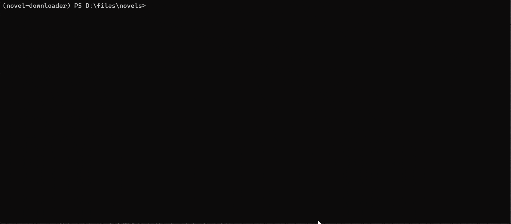

## CLI 使用示例

支持的站点列表详见: [站点支持文档](../supported-sites/index.md)

### 快速开始

```bash
# 根据 URL 下载书籍
novel-cli download https://www.hetushu.com/book/5763/index.html

# 指定站点下载 (例如 b520)
novel-cli download --site b520 8_8187

# 导出为 EPUB
novel-cli export --format epub 88888
```

---

### 登录/鉴权

当配置启用 `login_required: true` 时, CLI 会检测登录状态; 若未登录, 将提示在命令行输入当前站点的有效 Cookie 或账号信息。

部分站点的搜索/下载必须先登录 (例如番茄小说)。除了手工粘贴 Cookie 外, 也可以让下载器打开一个真实浏览器窗口完成登录, 自动抓取并保存会话 Cookie:

```bash
# 打开登录窗口, 登录成功后 Cookies 会保存到 <缓存目录>/<站点>/
novel-cli login fanqienovel

# 查看支持交互式登录的站点
novel-cli login --list
```

---

### 全局用法与帮助

```text
novel-cli [-h] [-v] [--lang LANG] COMMAND [ARGS]...

Options:
  -h, --help     显示此帮助信息并退出
  -v, --version  显示程序版本号并退出
  --lang LANG    覆盖本次运行使用的界面语言（例如 en、zh）。需放在子命令之前。
```

> 所有子命令均支持 `--help` 查看对应帮助文本。

---

### 子命令总览

```text
Commands:
  download    通过书籍 ID 或 URL 下载小说
  search      在一个或多个站点搜索书籍
  browse      浏览站点的排行榜与分类
  follow      追更书籍并检查新章节
  export      导出已下载的小说
  login       为站点打开登录窗口并保存其会话 Cookies
  config      管理应用配置和设置
  clean       清理应用日志、缓存与书籍数据
  storage     显示应用数据目录的磁盘占用
  doctor      检查运行环境并诊断常见问题
  sources     列出、校验、安装和移除规则书源
  music       搜索并下载来自多个音乐平台的歌曲
  completion  输出 novel-cli 的 shell 补全脚本
  batch       按 `title author` 书单批量搜索并可选下载
  update      检查新版本并按需下载
```

共 15 个子命令。`batch` 与 `update` 由入口点追加注册, 因此排在 `completion` 之后。

---

#### 1. download 子命令

下载完整小说, 支持三种方式:

1. **直接传入 URL**
2. **指定站点 + 书籍 ID**
3. **省略参数, 从配置文件读取 ID**

**Synopsis**

```bash
novel-cli download [-h] [--site SITE] [--config CONFIG] [--start START] [--end END] [--no-export] [--format FORMAT [FORMAT ...]] [--json] [--strict] [book_ids ...]
```

**Options**

* `book_ids | url`:
    * 输入书籍 ID (配合 `--site` 使用)
    * 输入书籍/章节 URL (自动解析站点与书籍 ID)
    * 省略时将从配置文件读取 `book_ids`
    * 首尾空白会被去除, 因此 `" 123 "` 与 `"123"` 指向同一本书、同一个数据目录; 完全相同的请求 (同一 `book_id`, 且 `--start`/`--end` 也相同) 会去重, 只下载一次, 而同一本书带不同范围仍按两个任务执行
* `--site SITE`: 站点键 (如 `qidian`, `b520`, ...), 若直接传入 URL, 可省略; 首尾空白会被去除, 空白值 (`--site ""`) 属于用法错误 (退出码 `2`)
* `--start START`: 起始章节**唯一 ID** (仅用于第一个 `book_id`); 首尾空白会被去除, 空白值属于用法错误 (退出码 `2`), 不会被当作 "不限范围"
* `--end`: 结束章节**唯一 ID**, **包含** (仅用于第一个 `book_id`); 空白处理同 `--start`
* `--no-export`: 仅下载, 不进行导出。启用后将跳过导出步骤
* `--format FORMAT [FORMAT ...]`: 导出格式: `txt` / `epub` / `html`, 可指定多个, 默认使用配置文件设定
* `--json`: 以多行缩进 JSON (`indent=2`) 输出到标准输出并退出 (结构见文末表格)
* `--strict`: 只要有章节下载失败就以非零状态退出; 缺章的书不会导出, 失败清单最多列出 20 条 (默认只警告并列出前 5 条)

> `--start` / `--end` 用于临时下载部分章节, 仅影响**第一个**命令行提供的 `book_id`。
>
> `--start` 和 `--end` 接收**章节唯一 ID**, 并非 "第几章" 的序号。
>
> 需要复杂范围/忽略章节等, 请在配置文件使用结构化 `book_ids`; 参见 [配置文件说明](./settings-reference.md)。

**Examples**


```bash
# 方式一: 直接通过 URL 启动下载
novel-cli download https://www.hetushu.com/book/5763/index.html

# 方式二: 指定站点 + 书籍 ID
novel-cli download --site b520 8_8187
novel-cli download --site n23qb 12282
novel-cli download --site qidian 1010868264

# 只下载部分章节
novel-cli download --site qidian 1010868264 --start 402902546 --end 406807540

# 仅下载, 跳过导出步骤
novel-cli download --no-export --site qidian 1010868264

# 方式三: 从配置文件中读取 ID
novel-cli download --site n23qb
```

---

#### 2. search 子命令

按关键字搜索小说

**Synopsis**

```bash
novel-cli search [-h] [--site SITE] [--config CONFIG] [--limit N] [--site-limit M] [--timeout SECS] [--format FORMAT [FORMAT ...]] [--json] [--first] [--sort {quality,priority,site,title,author,words,update}] [--min-words N] [--max-words N] [--updated-after YYYY-MM-DD] [--group | --no-group] keyword [keyword ...]
```

**Options**

* `keyword`: 搜索关键字
* `--site SITE`, `-s SITE`: 指定搜索站点, 可多次使用以指定多个站点, 不指定则搜索全部支持站点
* `--limit N`, `-l N`: 总体结果上限 (最小 1), 默认为**不限制**
* `--site-limit M`: 单站点结果上限 (最小 1), 默认为 `10`
* `--timeout SECS`: 每个站点的墙钟预算 (秒), 默认为 `5.0`; 超时站点会被丢弃, 整体耗时约等于该值
* `--format FORMAT [FORMAT ...]`: 结果确认后自动下载时的导出格式 (默认使用配置文件设定)
* `--json`: 将所有搜索结果以 JSON 输出到标准输出后退出 (便于脚本消费)
* `--first`: 直接下载排名第一的结果, 无需确认 (非交互模式)
* `--sort {quality,priority,site,title,author,words,update}`: 结果排序方式, 默认为 `quality` (优选)
* `--min-words N` / `--max-words N`: 字数过滤 (含边界), 取值为 `0`–`1000000000`。站点返回的 `word_count` 会按排名层同一套规则解析 (`"30万字"`、`"1,234"`); 设置后, **没有字数或无法解析**的结果会被丢弃。省略即不过滤。
* `--updated-after YYYY-MM-DD`: 只保留该日期**当天及之后**更新的结果 (下界, 含当天); 严格使用 `YYYY-MM-DD`。设置后, **没有更新日期或无法解析**的结果会被丢弃。省略即不过滤。
* `--group` / `--no-group`: 合并跨站点的同名书, 每本书只占一行, `site` 列列出全部来源 (`*` 标记最佳来源)。默认不合并 (`--no-group`)。过滤在分组与 `--limit` 截断之前生效。
* 关键词支持 2–4 个词的「书名 + 作者」式查询: 空格 (含全角)、`·`、`,`、`，`、`-` 会把它拆成多个词, 分别匹配标题与作者; 整串关键词仍参与评分。例如 `"斗破苍穹 天蚕土豆"`。多词拆分只影响排序评分, **不改变缓存 key**。

**Examples**



```bash
# 搜索所有站点 (默认全部)
novel-cli search 三体

# 指定单个站点 (如 b520)
novel-cli search --site b520 三体

# 搜索 b520, 返回最多 5 条结果
novel-cli search --site b520 --limit 5 三体

# 总体返回最多 20 条, 每站点最多 5 条
novel-cli search --limit 20 --site-limit 5 三体

# 指定多个站点 (b520 和 n23qb)
novel-cli search -s b520 -s n23qb 三体

# 书名 + 作者一起搜: 两个词分别匹配标题与作者
novel-cli search "斗破苍穹 天蚕土豆"

# 只看 30 万字以上、100 万字以下的作品
novel-cli search 斗破苍穹 --min-words 300000 --max-words 1000000

# 只看 2024-01-01 当天及之后更新的结果
novel-cli search 斗破苍穹 --updated-after 2024-01-01

# 过滤 + 合并 + 单行 JSON, 便于脚本消费
novel-cli search 斗破苍穹 --min-words 300000 --updated-after 2024-01-01 --group --json
```

过滤参数只缩小本次结果集, 不改变排序评分或响应字段; 不同过滤组合会作为不同请求分别缓存, 不会复用未过滤的快照。`--json` 输出仍是结果数组。日期或字数格式非法时以用法错误 (退出码 `2`) 退出, 不会退化成「无过滤」。

!!! note "番茄为什么不在聚合搜索里"
    番茄的搜索接口要客户端签名, 且**不需要登录**。显式指定站点时会直接走官方 App 接口: 首次使用自动注册一台设备身份 (落盘复用), 之后 `x-argus` / `x-gorgon` / `x-ladon` 全部本地现算, 无需浏览器窗口。

    ```bash
    novel-cli search -s fanqienovel 斗破苍穹
    ```

    聚合搜索仍然跳过番茄, 以保持「快、不弹窗」的既有约定; 只有 App 接口不可用时才回退到浏览器辅助搜索 (此时需要可选的浏览器组件, 缺失会给出安装提示)。

---

#### 2.1 browse 子命令

不靠关键字, 直接浏览站点自己发布的榜单与分类 (目前由番茄提供)

**Synopsis**

```bash
novel-cli browse [-h] [--categories] [--category ID|NAME] [--gender {1,2,female,male}] [--limit N] [--config CONFIG] [--json] [--first] site
```

**Options**

* `site`: 站点标识 (例如 `fanqienovel`)
* `--categories`: 列出该站点的分类 (按频道分组) 后退出
* `--category ID|NAME`: 列出某个分类下的书籍, 支持分类 ID 或中文名称; 同名分类按 `--gender` 优先匹配
* `--gender {male,female,1,2}`: 分类所属频道, 默认为 `male`
* `--limit N`: 显示的条目数, 默认为 `20`
* `--json`: 以 JSON 输出条目后退出
* `--first`: 交互选择后直接下载第一条, 无需确认 (非交互)

**Examples**

```bash
# 看有哪些分类
novel-cli browse fanqienovel --categories

# 总榜前 10 条
novel-cli browse fanqienovel --limit 10

# 按分类名取书 (不必知道 ID)
novel-cli browse fanqienovel --category 西方奇幻 --limit 20

# 脚本消费
novel-cli browse fanqienovel --category 1141 --json
```

!!! note "为什么番茄能浏览"
    分类列表来自榜单页 `window.__INITIAL_STATE__` 里的 `rankCategoryTypeList` (男频 19 + 女频 18), 书目则走 `/api/library/book_list`, 只要参数带上 `word_count=0&sort=0` 就不需要任何签名。

---

#### 3. export 子命令

导出已下载的小说为指定格式

**Synopsis**

```bash
novel-cli export [-h] [--format FORMAT [FORMAT ...]] [--site SITE] [--config CONFIG] [--start START] [--end END] [--stage STAGE] [--out DIR] [--json] [book_ids ...]
```

**Options**

* `book_ids`: 要导出的一个或多个书籍 ID (可选; 若省略则会交互式选择)
* `--format FORMAT [FORMAT ...]`: 导出格式: `txt` / `epub` / `html`, 可指定多个, 默认使用配置文件设定
* `--site SITE`: 站点键 (如 `b520`, `qidian`, ...), (可选; 若省略则会交互式选择)
* `--config CONFIG`: 指定配置文件路径 (可选)
* `--start START`: 起始章节 ID (仅对第一本书生效)
* `--end END`: 结束章节 ID (仅对第一本书生效)
* `--stage STAGE`: 导出阶段 (例如 `raw`、`cleaner`), 默认使用最后阶段
* `--out DIR`: 覆盖导出目录, 仅影响最终导出文件; 原始数据仍从 `general.raw_data_dir` 读取, 不会被写入或改变。省略时使用配置中的 `general.output_dir`。支持 `~` 与环境变量, 目录不存在时会自动创建 (父目录一并创建)
* `--json`: 以 JSON 输出到标准输出并退出 (结构见文末表格)

**Examples**


```bash
# 指定导出格式为 EPUB
novel-cli export --format epub

# 指定站点来源并导出多本书
novel-cli export --site b520 12345 23456

# 把导出文件写到指定目录 (原始数据目录不变, 目录会自动创建)
novel-cli export --site b520 12345 --out ~/exports

# 省略 site 和 book_ids, 进入交互模式选择站点和书籍
novel-cli export
```

> 提示: 未指定 `--site` 或 `book_id` 时, 将进入交互模式, 从已有下载的站点和书籍中进行选择。

!!! note "EPUB 内置可访问性元数据"
    导出的 EPUB 会在 OPF 中写入 EPUB 3 / schema.org 可访问性声明, 阅读器与无障碍工具可直接读取:

    * `schema:accessMode = textual` — 纯文本内容
    * `schema:accessibilityHazard = none` — 无已知无障碍风险
    * `schema:accessibilitySummary` — 按书籍语言生成的中/英简介
    * 含至少一个章节文档时额外声明 `schema:accessibilityFeature = structuralNavigation` (结构化目录)

    整书、分卷与单章导出使用同一套规则; 元数据不含时间戳等运行期信息, 因此重复导出同一本书得到相同的声明。

    EPUB 2 阅读器会忽略这些 `<meta property>` 声明, 不影响正文与基于 NCX 的目录导航 (能否打开 EPUB 3 包仍取决于阅读器)。查看方式: 解压 EPUB 后打开 `OEBPS/content.opf`, 或在 Calibre 中使用「编辑书籍」。这些是内容特征声明, 不代表已通过 EPUBCheck 或完成无障碍测试。

---

#### 4. config 子命令

初始化和管理下载器设置, 包括切换语言等

**Synopsis**

```bash
novel-cli config COMMAND [ARGS]...
```

**Subcommands**

* `init [--force]`: 在当前目录初始化默认配置文件 (`./settings.toml`); `--force` 覆盖已存在文件
* `set-lang LANG`: 切换 CLI 语言 (`zh_CN` / `en_US`)

**Examples**

```bash
# 切换界面语言为英文
novel-cli config set-lang en_US

# 初始化默认配置到当前目录
novel-cli config init

# 强制覆盖已存在的配置文件
novel-cli config init --force
```

---

#### 5. clean 子命令

用于清理应用运行过程中产生的**内部状态 / 日志 / 站点缓存 / 书籍原始数据**。

清理后, 下次运行会自动重新生成对应资源 (如重新抓取 metadata / 章节 / 媒体等)。

`clean` 包含 4 个子命令:

* `state`: 清理内部状态文件 (运行时状态、临时信息)
* `logs`: 清理应用日志文件
* `cache`: 清理站点级缓存 (字体/共享资源等, 按站点目录划分)
* `book`: 清理书籍原始缓存数据 (章节 SQLite / metadata / media / 或整书目录)

**Synopsis**

```bash
novel-cli clean [-h] {state,logs,cache,book} ...
```

**Examples**

```bash
# 查看 clean 总帮助
novel-cli clean --help
```

---

#### 5.1 clean state 子命令

清理内部状态文件 (例如运行时记录、临时信息)

**Synopsis**

```bash
novel-cli clean state [-h] [-y]
```

**Options**

* `-y, --yes`: 跳过确认提示, 直接执行

**Examples**

```bash
# 清理内部状态
novel-cli clean state

# 强制清理 (跳过确认)
novel-cli clean state --yes
```

---

#### 5.2 clean logs 子命令

清理应用生成的日志文件。

**Synopsis**

```bash
novel-cli clean logs [-h] [--config CONFIG] [-y] [--dry-run]
```

**Options**

* `--config CONFIG`: 配置文件路径
* `-y, --yes`: 跳过确认提示
* `--dry-run`: 仅显示将被删除的日志文件, 不实际删除

**Examples**

```bash
# 试运行: 查看将要删除的日志文件
novel-cli clean logs --dry-run

# 清理日志
novel-cli clean logs

# 强制清理日志 (跳过确认)
novel-cli clean logs -y

# 指定配置文件位置
novel-cli clean logs --config ./settings.toml
```

---

#### 5.3 clean cache 子命令

清理站点级缓存目录, 缓存目录结构为:

```
<cache_dir>/<site_key>/
```

例如站点共享字体或解析缓存等。

**Synopsis**

```bash
novel-cli clean cache [-h] [--config CONFIG] [--site SITE] [-y] [--dry-run] [--json]
```

**Options**

* `--config CONFIG`: 配置文件路径
* `--site SITE`: 站点键值 (如 `qidian`, `b520`), 省略时清理全部站点缓存。
  该值会被拼到缓存根目录下再删除, 因此只接受**单个目录名**: `..`、`../..`、
  `/etc`、含 `/`、`\`、`:` 或控制字符的值都会以用法错误退出 (`2`),
  不会触碰缓存目录之外的任何文件
* `-y, --yes`: 跳过确认提示
* `--dry-run`: 只报告将要删除的路径与各路径的文件数/字节数, **不删除任何文件** (零删除)。与真实删除共用同一套路径校验, `--site` 越界同样以用法错误 (`2`) 退出
* `--json`: 输出单行 JSON 报告, 必须与 `--dry-run` 同用 (否则以 `2` 退出)。固定含 `dry_run`、`command`、`site`、`book_id`、`book_ids`、`items`、`paths`、`files`、`bytes`; `items[]` 含 `path`、`kind`、`files`、`bytes`

**Examples**

```bash
# 清理指定站点缓存
novel-cli clean cache --site qidian

# 清理全部站点缓存 (删除整个 cache_dir)
novel-cli clean cache

# 跳过确认提示
novel-cli clean cache --site b520 -y

# 指定配置文件
novel-cli clean cache --config ./settings.toml

# 先预览会删什么 (零删除), 确认后再真正清理
novel-cli clean cache --site qidian --dry-run

# 脚本消费: 单行 JSON 报告
novel-cli clean cache --site qidian --dry-run --json
```

---

#### 5.4 clean book 子命令

清理一本或多本书的原始缓存数据, 数据目录结构为:

```
<raw_data_dir>/<site_key>/<book_id>/
```

默认会删除章节 SQLite 数据 (可按 `--start/--end` 限定范围)

可按需指定是否删除 media 或整书目录。

**Synopsis**

```bash
novel-cli clean book [-h]
    [--site SITE] [--config CONFIG]
    [--start START] [--end END]
    [--stage STAGE]
    [--no-chapters] [--metadata] [--media] [--all]
    [-y] [--dry-run] [--json]
    [book_ids ...]
```

**Options**

* `book_ids`: 一个或多个书籍 ID
* `--site SITE`: 站点键值 (与 `clean cache --site` 相同, 只接受单个目录名;
  `..`、路径分隔符、盘符等越界值以 `2` 退出)
* `--config CONFIG`: 配置文件路径
* `--start START`: 起始章节 ID (仅对第一本书生效)
* `--end END`: 结束章节 ID (仅对第一本书生效, **包含 end**)
* `--stage STAGE`: 清理阶段 (如 `raw`, `cleaner`), 默认 `raw`
* `--no-chapters`: 不删除章节数据 (SQLite 不动)
* `--metadata`: 删除 metadata JSON
* `--media`: 删除媒体资源目录 (图片等)
* `--all`: 删除该书**全部原始数据目录** (忽略其他清理选项), 若同时省略 `book_ids`, 则清理指定站点/全部站点的整站 raw_data
* `-y, --yes`: 跳过确认提示
* `--dry-run`: 只报告将要删除的路径与各路径的文件数/字节数, **不删除任何文件** (零删除)。与真实删除共用同一套路径校验 (`--site` 越界、非法 `--stage` 同样以 `2` 退出)
* `--json`: 输出单行 JSON 报告, 必须与 `--dry-run` 同用 (否则以 `2` 退出)。固定含 `dry_run`、`command`、`site`、`book_id` (仅一本书时为其 ID, 否则为 `null`)、`book_ids`、`items`、`paths`、`files`、`bytes`; `items[]` 含 `path`、`kind`、`files`、`bytes`, 其中 `kind` 为 `rows` 表示只清理数据库内的章节行、数据库文件本身保留

**Examples**

```bash
# 默认清理
novel-cli clean book --site qidian 1010868264

# 清理指定范围章节 (仅第一本书生效)
novel-cli clean book --site qidian 1010868264 --start 402902546 --end 406807540

# 只清理 metadata, 不清章节
novel-cli clean book --site qidian 1010868264 --no-chapters --metadata

# 清理 media (图片等)
novel-cli clean book --site qidian 1010868264 --media

# 删除整本书所有原始数据 (直接删目录)
novel-cli clean book --site qidian 1010868264 --all

# 删除指定站点全部 raw_data (省略 book_ids 且 --all)
novel-cli clean book --site qidian --all

# 删除全部站点 raw_data (省略 site 且 --all)
novel-cli clean book --all

# 跳过确认提示
novel-cli clean book --site qidian 1010868264 --all -y

# 预览整本书会删什么 (零删除)
novel-cli clean book --site qidian 1010868264 --all --dry-run

# 预览指定站点全部 raw_data, 并输出 JSON
novel-cli clean book --site qidian --all --dry-run --json
```

> 提示: `--start/--end` 接收**章节唯一 ID**, 并非 "第几章" 的序号

---

#### 6. login 子命令

为需要登录的站点打开一个真实浏览器窗口, 登录成功后自动保存会话 Cookie, 供后续搜索/下载复用。

需要安装可选的图形界面组件, 否则命令会提示安装。

**Synopsis**

```bash
novel-cli login [-h] [--timeout SECONDS] [--list] [site]
```

**Options**

* `site`: 站点键, 默认为 `fanqienovel`
* `--timeout SECONDS`: 等待登录完成的秒数, 默认 `300`
* `--list`: 列出支持交互式登录的站点

**Examples**

```bash
# 登录番茄小说并保存 Cookies
novel-cli login fanqienovel

# 自定义等待时间 (秒)
novel-cli login fanqienovel --timeout 600

# 查看支持交互式登录的站点
novel-cli login --list
```

> 保存位置: `<缓存目录>/<站点>/aiohttp.cookies`
>
> 登录窗口关闭且未检测到登录时命令以非零状态退出, 不会保存任何 Cookies。

---

#### 7. music 子命令

搜索并下载来自多个音乐平台的歌曲。该功能依赖可选组 `music`, 未安装时命令会打印安装提示:

```bash
pip install "novel-downloader[music]"
```

`music` 包含五个子命令: `platforms`、`search`、`download`、`export-m3u`、`health`。

**Synopsis**

```bash
novel-cli music [-h] {platforms,search,download,export-m3u,health} ...

novel-cli music platforms [-h] [--json]

novel-cli music search [-h] [--platform KEY] [--limit N] [--json] keyword

novel-cli music download [-h] [--keyword KEYWORD] [--platform KEY] [--limit N]
                         [--level {hires,lossless,exhigh,higher,standard}]
                         [--out DIR] [--pick N[,N|ID]] [--yes] [--json]
                         [KEYWORD]

novel-cli music export-m3u [-h] --keyword KEYWORD [--platform KEY] [--limit N]
                           [--out FILE]

novel-cli music health [-h] [--platform KEY] [--keyword KEYWORD] [--json]
```

**General Options**

* `--platform KEY`: 音乐平台标识。`search` 与 `download` 默认 `all` (聚合搜索全部平台, 同一首歌合并为一行并标注来源), 也可传具体平台 key; `export-m3u` 默认 `netease`。完整列表见 `novel-cli music platforms`
* 平台名不区分大小写, 并且接受 `music platforms` 打印的显示名 (如 `网易云音乐`、`国内 · 网易云音乐`) 与常见别名 (`163`、`NetEase`、`网易云` 等)。未知平台以用法错误 (`2`) 退出, 并列出可用 key。
* `--limit N`, `-l N`: 最大结果数, 默认 `20`

**platforms**

列出可用的音乐平台及其说明。`--json` 输出一个 `{平台 key: 显示名}` 对象, 便于脚本读取:

```bash
novel-cli music platforms
novel-cli music platforms --json
```

**search**

按关键字搜索歌曲, 默认搜索全部平台。结果表格包含序号、标题、歌手、专辑、时长、是否 VIP; 全部平台模式下额外显示来源平台:

```bash
# 搜索全部平台 (默认)
novel-cli music search "关键词" --limit 10

# 只搜索网易云音乐
novel-cli music search "关键词" --platform netease --limit 10
```

* `--json`: 以 JSON 输出搜索结果 (包含 `platform`、`keyword`、`total` 与 `tracks` 列表) 后退出, 便于脚本消费; 聚合搜索时额外包含每个平台的 `sources` 与响应级 `platforms` 统计

```bash
novel-cli music search "关键词" --json
```

**download**

先搜索, 再选择并下载歌曲:

* 位置参数 `KEYWORD` 或 `--keyword KEYWORD`: 下载前搜索的关键词 (二选一)
* `--level`: 音质档位, 可选 `hires` / `lossless` / `exhigh` / `higher` / `standard`; 省略时取音乐设置, 通常为 `exhigh`
* `--out DIR`: 输出目录; 省略时取音乐设置 (未配置则使用默认下载目录)
* `--pick N[,N|ID]`: 无需确认, 按搜索结果序号 (从 1 开始) 或歌曲 ID 下载, 可传入多个值
* `--yes`: 无需确认, 直接下载全部搜索结果
* `--json`: 以**单行** JSON 输出下载报告后退出。选择流程不受影响: 仍需 `--pick` 或 `--yes`, 非交互环境必须显式提供, 否则会进入分页选择界面 (或报用法错误)。顶层含 `platform`、`keyword`、`out_dir`、`level`、`total`、`ok`、`skip`、`fail`、`lyrics_written` 与 `results`; `platform=all` 时额外含 `platforms` 统计。`results[]` 逐首记录 `id`、`name`、`artists`、`album`、`duration_s`、`vip`、`platform`、`sources`, 并按结果追加:
  * `status`: `ok` / `skip` / `fail`;
  * `path`: 有可用的本地音频路径且状态为 `ok`/`skip` 时才有;
  * `lyric_path`: 仅当原文歌词 `<stem>.lrc` 真正写在音频旁时才有 (译文 `<stem>.zh.lrc` 不单独报告);
  * `reason`: 仅失败且引擎给出原因时才有。

  部分歌曲失败时 JSON 仍会**先完整输出**, 随后命令以 `1` 退出; 搜索无结果时也会输出一份 `total=0`、`results=[]` 的合法文档, 调用方无需特判空 stdout。不带 `--json` 时, 有歌词写出会额外在 stderr 打印 `Lyrics written: N`。

未指定 `--pick` 或 `--yes` 且处于交互式终端时, 会进入分页选择界面 (输入编号、`a` 全选、`n` 下一页、`p` 上一页, 回车取消)。非交互式环境下必须显式提供 `--pick` 或 `--yes`。

**export-m3u**

把搜索到的**已下载**曲目写成 M3U 歌单, 不下载音频。只有带本地文件路径的曲目会写入; 没有路径的曲目计入跳过, 一首都没有时命令失败:

* `--keyword KEYWORD, -k KEYWORD` (必填): 用于搜索待添加歌曲的关键词
* `--out FILE`: 歌单路径, 默认 `<输出目录>/<关键词>.m3u8`

```bash
novel-cli music export-m3u --keyword "关键词" --platform netease --limit 10
```

**health**

逐个平台执行一次受限搜索 (只取 1 条结果), 检查平台是否可正常连通; 用于排查网络或平台故障。搜索成功但结果为空也算连通 (如未配置凭据的鉴权型平台):

* `--platform KEY`: 只检查指定平台, 省略时检查全部平台; 接受平台 key、显示名与别名 (规则同上)
* `--keyword KEYWORD`: 连通性探测使用的关键词, 默认 `test`
* `--json`: 以单行 JSON 输出 `{"keyword", "platforms": [{"platform", "ok", "elapsed_ms", "error"}], "failed"}`, 字段名与 `GET /api/v1/music/health` 一致; 任一平台失败时命令仍以 `1` 退出, JSON 会先完整输出

```bash
# 检查全部平台
novel-cli music health

# 只检查网易云 (key、显示名或别名均可)
novel-cli music health --platform netease
novel-cli music health --platform 网易云音乐

# 脚本消费: 机器可读结果
novel-cli music health --json
```

**Examples**

```bash
# 查看可用平台
novel-cli music platforms

# 搜索全部平台 (默认)
novel-cli music search "关键词"

# 只搜网易云音乐
novel-cli music search "关键词" --platform netease

# 在 QQ 音乐搜索并输出 JSON
novel-cli music search "关键词" --platform qq --json

# 下载第 1 条搜索结果
novel-cli music download "关键词" --pick 1

# 下载第 1、3 条结果, 指定高解析度音质与输出目录
novel-cli music download "关键词" --pick 1,3 --level hires --out ./music

# 下载全部搜索结果 (无需确认)
novel-cli music download "关键词" --yes

# 通过搜索结果中的歌曲 ID 下载
novel-cli music download "关键词" --pick 123456789

# 机器可读: 统计本次写出的歌词数
novel-cli music download "关键词" --yes --json | jq '.lyrics_written'
```

> 下载进度、标签写入、封面与歌词保存等行为遵循音乐设置 (如 `embed_tags`、`embed_cover`、`save_lyric`、`split_folder`、`skip_existing`)。

---

#### 8. follow 子命令

维护一份「追更列表」, 并检查已关注书籍是否发布了新章节。

追更记录保存在应用主目录的 `watchlist.json` 中 (即 `NOVEL_HOME`, 默认 `%LOCALAPPDATA%\novel_downloader\watchlist.json`), 与 `settings.toml` 中的 `book_ids` 相互独立。

**Synopsis**

```bash
novel-cli follow [-h] {add,remove,list,check} ...

novel-cli follow add [-h] [--title TEXT] site book_id
novel-cli follow remove [-h] site book_id
novel-cli follow list [-h] [--json]
novel-cli follow check [-h] [--all] [--download] [--wait]
                       [--wait-timeout SECS] [--timeout SECS]
```

**add / remove**

* `site`: 站点键 (如 `b520`, `qidian`)
* `book_id`: 书籍 ID
* `--title TEXT` (仅 `add`): 检查新章节时用于搜索的显示标题。省略时 `follow check` 只能拿 `book_id` 当关键字搜索, 命中率较低, 建议始终提供。

```bash
# 加入追更列表
novel-cli follow add b520 8_8187 --title "示例小说"

# 重复 add 会更新已有条目 (不会清掉已记录的最新章节)
novel-cli follow add b520 8_8187 --title "示例小说（修订名）"

# 移除
novel-cli follow remove b520 8_8187
```

**list**

```bash
# 表格输出: 站点 / 书籍 ID / 标题 / 最新章节 / 更新时间
novel-cli follow list

# 机器可读输出 (JSON 数组)
novel-cli follow list --json
```

`--json` 的每个元素包含 `site`、`book_id`、`title`、`last_chapter`、`updated_at`。

**check**

* `--all`: 同时显示已是最新的书籍和未找到结果的书籍; 省略时只报告新章节和错误。
* `--download`: 对发现新章节的书打印可直接执行的 `novel-cli download ...` 命令。
* `--wait`: 配合 `--download` 使用, 实际执行下载: 把有新章节的书在任务管理器中逐本排队下载, 并等待每本结束后再处理下一本。
* `--wait-timeout SECS`: 每本下载的等待上限 (秒), 默认 `1800`; 仅在 `--wait` 下生效。
* `--timeout SECS`: 每本书的搜索超时, 默认 `5.0` 秒。

```bash
# 只检查并报告新章节
novel-cli follow check

# 显示所有书籍的状态
novel-cli follow check --all

# 有新章节时, 额外打印下载命令
novel-cli follow check --download

# 有新章节时自动逐本下载并等待完成 (每本最多等默认的 1800 秒)
novel-cli follow check --download --wait

# 自定义每本下载的等待上限 (例如 1 小时)
novel-cli follow check --download --wait --wait-timeout 3600
```

`check` 默认只做搜索, **不会直接下载**: 下载是长任务, CLI 没有后台调度器, 因此它只打印命令, 保持命令快速、非阻塞、可预测。需要自动下载时有两种方式: 把打印出的 `novel-cli download --site <site> <book_id>` 交给计划任务 (见 [常见任务配方](./recipes.md)), 或改用 `follow check --download --wait`, 让 CLI 自己逐本下载并等待完成。

`--wait` 的语义:

* **逐本下载**: 有新章节的书按顺序逐本排队下载, 一本结束 (完成/失败/取消) 后才开始下一本, 不会并发施压站点。
* **超时计为取消**: `--wait-timeout` 限定单本的等待时间; 超时的任务会被取消, 在汇总中计为「已取消」, 其余书籍仍有各自完整的等待时间。
* **汇总输出**: 全部结束后打印 `Download summary: X completed, Y cancelled, Z failed.` 样式的汇总。
* **退出码**: 只有没有检查失败且所有下载都成功完成时才返回 `0`; 任意检查失败, 或任意一本下载失败/取消/超时, 都以 `1` 结束。
* `--wait` 必须与 `--download` 同用, 否则属于用法错误 (退出码 `2`)。

> 首次检查某本书时, 只会记录当前最新章节 (显示为 `First chapter recorded ...`), 不会误报为更新。
>
> 只要有任意一本书检查失败 (网络/插件异常), 命令最终以退出码 `1` 结束, 即使其它书检查成功。

---

#### 9. storage 子命令

统计应用四个数据目录的磁盘占用, 并可一次性清理:

| 类别 | 目录来源 |
| --- | --- |
| Raw data | `general.raw_data_dir` |
| Cache | `general.cache_dir` |
| Downloads | `general.output_dir` |
| Logs | `general.debug.log_dir` |

不指定子命令时报告各数据目录的磁盘占用; 另提供 `backup` / `restore` / `verify` 三个子命令备份、恢复与校验章节数据库。

**Synopsis**

```bash
novel-cli storage [-h] [--json] [--clean] [-y] [--dry-run] [{backup,restore,verify} ...]
```

**Options**

* `--json`: 以 JSON 输出统计结果到标准输出并退出。
* `--clean`: 打印表格后删除上述已存在的数据目录 (等同于批量清理 raw/cache/downloads/logs)。
* `-y, --yes`: 跳过 `--clean` 的确认提示。
* `--dry-run`: 只报告 `--clean` 将要删除的目录与占用, **不删除任何文件** (零删除)。与真实清理共用同一套路径校验; 单独使用 (不带 `--clean`) 以用法错误 (`2`) 退出。可与 `--json` 同用, 输出结构见文末表格。
* `--json` 与 `--clean` 不能同时使用 (退出码 `2`), 除非同时加上 `--dry-run`。

**Examples**

```bash
# 查看占用
novel-cli storage

# 机器可读输出
novel-cli storage --json

# 预览 --clean 会删什么 (零删除)
novel-cli storage --clean --dry-run

# 预览并输出单行 JSON
novel-cli storage --clean --dry-run --json

# 清理全部数据目录 (会要求确认)
novel-cli storage --clean

# 跳过确认 (脚本/计划任务中使用)
novel-cli storage --clean -y
```

`--json` 的结构为 `{ "raw": {...}, "cache": {...}, "downloads": {...}, "logs": {...}, "total": {...} }`; 每个目录对象包含 `label`、`path`、`files`、`bytes`、`free_bytes` 与 `top` (按子目录拆分的 `name`/`files`/`bytes`), `total` 包含 `files`、`bytes`、`reclaimable_bytes` 与 `reclaimable_files`。

##### 9.1 storage backup 子命令

把 `raw_data` 下每个 `chapter.<stage>.sqlite` 做一致性快照 (SQLite online backup, 包含仍在 WAL 中的数据), 并按 `<site>/<book>` 目录结构写入带 UTC 时间戳的副本。

**Synopsis**

```bash
novel-cli storage backup [-h] --out OUT [--json] [--keep N] [--dry-run]
```

**Options**

* `--out OUT`: 接收备份文件的目录 (必填)。支持 `~` 与环境变量, 不存在时会自动创建; 每本书生成 `<out>/<site>/<book>/chapter.<stage>.<YYYYMMDDTHHMMSSZ>.sqlite`。若目标文件已存在则拒绝覆盖
* `--json`: 输出单行 JSON 报告, 含 `command`、`ok`、`timestamp`、`out`、`count`、`bytes`、`files[]` (`source`、`target`、`bytes`、`sha256`、`schema_version`、`chapters`) 与 `retention` (`keep`、`dry_run`、`candidates`、`removed`、`failed`); 没有可备份的数据库时 `count` 为 `0`、`files` 为空数组
* `--keep N`: 备份成功并发布新文件后, 每本书的**每个 stage** 只保留最新 `N` 份, 更旧的删除; `0` (默认) 关闭清理。`N` 为负数时以用法错误 (`2`) 退出
* `--dry-run`: 只报告 `--keep` 会删除哪些旧备份, **不删除任何文件**; 新备份仍会正常写入。必须与 `--keep N` (`N > 0`) 同用, 否则以用法错误 (`2`) 退出

`--keep` 的删除范围是硬边界: 只考虑 `--out` 下文件名严格匹配 `chapter.<stage>.<YYYYMMDDTHHMMSSZ>.sqlite` 的**普通文件**, 目录、符号链接和任何其他命名 (包括手工改名或旧版本留下的文件) 一律不碰。分组键是「所在书籍目录 + stage」, 因此同一本书的 `raw` 与 `cleaner` 各自保留 `N` 份, 不会互相挤掉; 本次运行刚写出的文件永远受保护, 即使系统时钟回拨也不会删掉新备份。若某个目录无法读取或删除失败, 命令以 `1` 退出并在 `retention.failed` / stderr 中报告, 但已完成的备份仍保留。

> 备份是完整快照, 不是增量; `--keep` 只做轮转, 不会压缩或合并历史备份。需要长期归档时请把旧副本移到另一位置, 而不是把 `N` 设得很大。

备份范围只有 `raw_data` 下的 `chapter.<stage>.sqlite` (章节正文与元数据), **不含** `settings.toml`、Cookie/token 等登录态 (它们在 `cache_dir`)、日志、图片/媒体或导出文件。因此恢复备份不会恢复登录态, 换机后仍需重新登录。备份是**明文** SQLite 文件, 且可能包含付费或私密正文, 请放在受控目录中, 不要提交到 Git 仓库或公开网盘。

**Examples**

```bash
# 备份所有章节数据库
novel-cli storage backup --out ~/novel-backups

# 备份后每本书、每个 stage 只保留最近 7 份
novel-cli storage backup --out ~/novel-backups --keep 7

# 先预览 --keep 7 会删掉哪些旧备份 (零删除, 新备份仍会写入)
novel-cli storage backup --out ~/novel-backups --keep 7 --dry-run

# 脚本消费
novel-cli storage backup --out ./backups --json

# 定时任务: 备份 + 轮转, 失败时退出非零
novel-cli storage backup --out ./backups --keep 14 --json
```

##### 9.2 storage verify 子命令

只读校验 `raw_data` 下所有 `chapter.<stage>.sqlite`, 不修改、不复制、不重命名任何文件:

**Synopsis**

```bash
novel-cli storage verify [-h] [--json]
```

**Options**

* `--json`: 输出单行 JSON 报告 `{ok, total, healthy, corrupt, errors[]}`, 每个错误含 `path` 与 `reason`

**检查内容**

* 写前先校验 WAL sidecar 的校验和; WAL 损坏会直接报告, 不会让 SQLite 应用一个坏日志。
* 以只读连接打开 (`mode=ro`), 并额外设置 `PRAGMA query_only = ON`; 需要临时快照时也只操作临时副本, 源文件字节不变。
* 复用 `restore` 的同一套校验: SQLite 完整性、schema 版本、必需列。任何一项不通过都记为 `corrupt` 并给出原因。
* 每个数据库输出一行 `ok` 或 `corrupt: <原因>`; 家目录前缀会显示为 `~`。

**退出码与边界**

* 全部健康 (包括一个数据库都没有) 退出 `0`; 任意一个损坏退出 `1`。
* 只扫描 `raw_data` 下的**在用**数据库, 不扫描 `storage backup --out` 的备份目录; 备份副本需用 `sha256sum` / `PRAGMA integrity_check` 校验 (见 9.4)。
* 校验是只读的, 不会「修复」损坏库; 确认损坏后应从备份 `restore`, 或删除该库让应用重新下载。

**Examples**

```bash
# 校验所有在用章节数据库
novel-cli storage verify

# 脚本消费: ok=true 才继续
novel-cli storage verify --json
```

##### 9.3 storage restore 子命令

从备份文件恢复章节数据库。写入前会校验文件 (SQLite 完整性、schema 版本、必需列), 校验通过后原子替换目标数据库。

**Synopsis**

```bash
novel-cli storage restore [-h] --from SOURCE [--to TARGET] [-y] [--json]
```

**Options**

* `--from SOURCE`: 要恢复的备份文件 (必填)
* `--to TARGET`: 要写入的数据库路径, 必须位于 `raw_data_dir` 内且文件名形如 `chapter.<stage>.sqlite`; 省略时按备份文件的 `<site>/<book>` 路径推断, 无法推断时以用法错误 (`2`) 退出
* `-y, --yes`: 允许替换已存在的数据库。替换前会先把它保存为同目录的 `chapter.<stage>.sqlite.pre-restore-<时间戳>.bak`; 不加 `--yes` 时拒绝覆盖 (退出码 `2`)
* `--json`: 输出单行 JSON 报告, 含 `command`、`ok`、`from`、`target`、`replaced_existing`、`pre_restore_backup`、`schema_version`、`chapters`、`bytes`、`sha256`

**Examples**

```bash
# 按备份内的站点/书籍路径恢复到 raw_data
novel-cli storage restore --from ~/novel-backups/qidian/1010868264/chapter.raw.20260102T030405Z.sqlite

# 恢复到显式指定的数据库路径, 并允许替换已有库 (会先备份)
novel-cli storage restore --from ./backup.sqlite --to ./raw_data/qidian/1010868264/chapter.raw.sqlite -y

# 脚本消费
novel-cli storage restore --from ./backup.sqlite -y --json
```

`--to` 的文件名必须形如 `chapter.<stage>.sqlite`, 且 `stage` 要与原库一致 (通常是 `raw` 或 `cleaner`)。写错阶段不会影响其他文件, 但应用随后读写的是另一个阶段的数据库, 看起来像“章节丢了”。

##### 9.4 备份 → 校验 → 恢复完整流程

1. 备份, 并把机器可读报告保存下来 (其中的 `sha256`、`schema_version`、`chapters` 用于下一步核对):

```bash
mkdir -p ~/novel-backups
novel-cli storage backup --out ~/novel-backups --json > ~/novel-backups/last-backup.json
```

2. 恢复前校验副本: 摘要必须与报告一致, SQLite 完整性检查必须返回 `ok`。`restore` 本身会再次执行完整性、schema 版本与必需列校验, 这一步只是为了提前发现复制不完整或磁盘损坏:

```bash
jq -r '.files[] | "\(.sha256)  \(.target)"' ~/novel-backups/last-backup.json | sha256sum -c -
sqlite3 ~/novel-backups/qidian/1010868264/chapter.raw.20260102T030405Z.sqlite 'PRAGMA integrity_check;'
# 期望输出: ok
```

以上命令需要 `jq`、`sha256sum` (Git Bash / Linux / macOS) 与 `sqlite3` 命令行工具; 没有 `sqlite3` 时可跳过完整性检查, `restore` 仍会强制执行同样的校验。

`novel-cli storage verify` 校验的是 `raw_data` 里的**在用**数据库 (只读), 不读取备份目录; 若要确认备份副本本身没坏, 仍用上面的 `sha256sum` / `PRAGMA integrity_check`。两者互补: 一个查当前数据, 一个查归档副本。

3. 恢复并核对结果。目标已存在时必须加 `-y`, 命令会先把旧库保存为同目录的 `chapter.<stage>.sqlite.pre-restore-<时间戳>.bak`:

```bash
novel-cli storage restore \
  --from ~/novel-backups/qidian/1010868264/chapter.raw.20260102T030405Z.sqlite \
  -y --json
```

`--json` 中 `replaced_existing` 表示是否覆盖了现有库, `pre_restore_backup` 是旧库的保存路径 (未覆盖时为 `null`), `chapters` 是恢复后的章节行数。若只想确认备份可用而不改动现有库, 去掉 `-y` 即可: 目标已存在时命令会以用法错误 (`2`) 退出, 且不会写入任何文件。

---

#### 10. doctor 子命令

执行一组**离线**自检, 用于快速定位环境问题。

**Synopsis**

```bash
novel-cli doctor [-h] [--port N] [--json] [--online] [--fix] [--dry-run] [--fix-age-days N]
```

**检查项**

* Python 版本是否 >= 3.11
* 包版本 (`--version` 的源码版本; 与已安装元数据不一致时会同时显示)
* 是否找到 `settings.toml` / `settings.json`
* 配置能否解析为根表, 以及校验错误/警告
* 核心依赖与可选 `api` 依赖是否可导入
* 输出目录能否创建并写入 (会创建该目录并写入/删除一个临时文件)
* 日志目录能否创建并写入
* 输出目录所在卷的剩余空间 (低于 512 MiB 只警告)
* 缓存目录大小与可由 `clean cache` 回收的空间 (仅提示)
* 已注册下载站点数量
* 抽样站点插件能否导入 (单个失败只警告, 全部失败才判定失败)
* 可加载的搜索器数量
* 可选音乐依赖 (`mutagen`、`qrcode`、`websocket`) — 缺失只提示, 不判定失败
* `127.0.0.1:<port>` 是否可绑定 (默认 8081)

**Options**

* `--port N`: 要检查可用性的 API 端口, 默认 `8081`。
* `--json`: 以 JSON 输出检查结果 (`status`、`warnings`、`summary` + `checks`) 到标准输出并退出。
* `--online`: 额外探测网络出口 (请求 `https://www.baidu.com` 与 `https://github.com`, 每个 2.5 秒超时); 该项仅为提示, 失败不会让命令退出非零。
* `--fix`: 只修复**可逆的本地状态**: 创建缺失的输出/缓存/日志目录, 并删除这三个根目录下超过 `--fix-age-days` 天的 `.tmp` / `.part` 文件。绝不修改配置、导出文件、登录态或网络设置。
* `--dry-run`: 预览 `--fix` 的动作 (隐含 `--fix`), **不创建、不删除任何文件**; 目录检查也转为只读探测, 缺失目录显示为「`--fix` 将创建」而不是失败。
* `--fix-age-days N` (`--max-age-days`): 只删除超过 `N` 天的临时文件, 默认 `7`; 小于 `1` 以用法错误 (`2`) 退出。

**`--fix` 的安全边界**

1. 动作只发生在配置解析出的输出、缓存、日志三个目录**内部**; 路径必须是绝对路径、不含 `..`, 且路径与根目录都不能经过符号链接。否则该动作记为 `skipped`, 不执行。
2. 每个动作在真正执行前会**再次校验**路径, 因此计划生成后目录被替换/软链接化也不会越界。
3. 删除目标必须是普通文件且 mtime 早于阈值; 目录、符号链接、刚写入的文件都会被跳过。
4. 不修复配置错误、缺失依赖、端口占用或网络问题 —— 这些仍按检查项给出建议。
5. `--fix` 在检查之前执行, 因此报告反映的是修复后的状态; 修复本身失败时命令以 `1` 退出, 被安全跳过的动作不会导致失败。

**Examples**

```bash
# 默认检查
novel-cli doctor

# 检查自定义 API 端口
novel-cli doctor --port 9000

# 预览会创建哪些目录、删除哪些过期临时文件 (零改动)
novel-cli doctor --fix --dry-run

# 实际修复, 只清理 14 天前的 .tmp/.part
novel-cli doctor --fix --fix-age-days 14

# 机器可读: checks + 本次修复的 fixed/skipped/errors
novel-cli doctor --fix --json
```

`--fix --json` 在常规文档之外追加 `dry_run`、`max_age_days`、`fixed`、`skipped`、`errors` 与 `fix_summary`; 每条修复记录的 `path` 已做脱敏 (家目录显示为 `~`, 其他绝对路径只保留尾部)。

> 所有必需检查通过时退出码为 `0`, 任意必需检查失败为 `1`。失败项下方会打印一条可执行的修复建议。可选检查 (`optional`) 只产生警告, 不影响退出码。

---

#### 11. completion 子命令

输出 `novel-cli` 的 shell 补全脚本。补全内容由命令树自动生成, 是一份扁平词表 (子命令名 + 选项名, 不含选项值), 因此新增子命令后无需手动维护脚本。

**Synopsis**

```bash
novel-cli completion [-h] [--shell {bash,zsh,fish,powershell}]
```

**Options**

* `--shell {bash,zsh,fish,powershell}`: 生成补全脚本的目标 shell; 省略时自动检测: `$SHELL` 的 basename 为 `bash`、`zsh` 或 `fish` 时跟随该 shell, 否则 Windows 默认 `powershell`, 其它平台默认 `bash`。

生成的脚本统一使用 LF 换行 (在 Windows 上也不会写出 CRLF), 因此可以直接重定向到文件后再 `source`。

**Examples**

```bash
# Bash: 当前会话立即生效; 写入 ~/.bashrc 可持久化
source <(novel-cli completion --shell bash)

# Zsh: 脚本自带 #compdef 声明, 在已启用补全的交互会话中 source 即可
source <(novel-cli completion --shell zsh)

# Zsh (持久化): 放入 fpath 中的目录, 文件名必须为 _novel-cli
novel-cli completion --shell zsh > "${fpath[1]}/_novel-cli"
```

```fish
# Fish: 持久化到自动加载目录, 之后每次补全都会读取该脚本 (无需改 config.fish)
mkdir -p ~/.config/fish/completions
novel-cli completion --shell fish > ~/.config/fish/completions/novel-cli.fish

# Fish: 只在当前会话生效
novel-cli completion --shell fish | source
```

```powershell
# PowerShell: 追加到 $PROFILE, 每次启动自动注册补全
novel-cli completion --shell powershell >> $PROFILE
```

---

#### 12. batch 子命令

从一份纯文本书单批量搜索, 可选地把命中的书下载并导出。每行一本书:

* `title author`: 以任意空白 (空格、Tab、全角空格) 分隔; 只有一个字段时按标题匹配 (会给出警告)。
* 标题本身含空格时, 用 **Tab** 分隔标题与作者 (`title<TAB>author`), 第一个 Tab 之前的空格仍属于标题。
* `#` 开头为注释, 空行忽略; 无法解析的行不会被静默丢弃, 而是汇总报告并以注释形式保留在未找到文件里。

**Synopsis**

```bash
novel-cli batch [-h] (--file PATH | --from-not-found PATH) [--site SITE]
                [--out DIR] [--strict-match] [--not-found PATH] [--force]
                [--download] [--interval SECONDS] [--verbose] [--config CONFIG]
```

**Options**

* `--file PATH`: 从 PATH 读取 `title author` 书单 (与 `--from-not-found` 二选一, 必填其一)
* `--from-not-found PATH`: 续跑上一次 `batch` 写出的未找到文件
* `--site SITE`: 只在这个站点搜索; 省略时搜索全部站点。`--from-not-found` 会沿用文件头 `# site=` 记录的站点 (记录为 `all` 时不沿用)
* `--out DIR`: 把导出文件写到 DIR, 原始缓存写到 `DIR/raw_data`; 省略时使用配置
* `--strict-match`: 标题与作者都必须精确匹配; 默认标题精确、作者取相似度最高者
* `--not-found PATH`: 未找到记录的写出路径; 默认 `logs/not_found_<site>.txt`
* `--force`: 覆盖不是本命令写出的同名 `--not-found` 文件
* `--download`: 下载并导出命中的书; 默认只报告匹配结果
* `--interval SECONDS`: 两次书目搜索之间的等待秒数, 默认 `0`
* `--verbose`: 显示候选数量与作者匹配细节
* `--config CONFIG`: 配置文件路径

**未找到文件与换源重试**

未找到文件与输入格式完全一致, 首行是 `# site=<site> searched_at=<时间> matches=<命中>/<总数>` 头, 末尾以 `#` 结束, 因此可以直接作为下一次 `batch --from-not-found` 的输入。典型换源流程:

```bash
# 1. 在全部站点搜索并下载
novel-cli batch --file books.txt --download

# 2. 某些书在主站没找到, 换一个源重试 (显式 --site 会覆盖文件里记录的站点)
novel-cli batch --from-not-found logs/not_found_all.txt --site biquge5r --download

# 3. 省略 --site 时沿用文件头记录的站点, 重新跑一遍
novel-cli batch --from-not-found logs/not_found_b520.txt --download
```

> 默认只报告匹配结果, 不加 `--download` 时不会下载。`--file` 输入永远是只读的: 即使加 `--force` 也不会把未找到结果写回输入文件。

**Examples**

```bash
# books.txt 每行 "标题 作者"
novel-cli batch --file books.txt
novel-cli batch --file books.txt --site b520 --download
novel-cli batch --file books.txt --download --interval 1.5 --verbose
```

---

#### 13. update 子命令

检查更新清单 (`latest.json`) 并可选地下载当前平台的 CLI 资产。检查与下载是两个独立步骤: `--check` 只检查, 下载必须显式触发。CLI 显式请求 `shape="cli"`，只选择 `novel-cli-<version>-<platform>.zip`；即使清单/API 里只有桌面安装包，也**不会回退**去下载 `NovelDownloader-setup-*.exe`。CLI 只负责**下载并校验**, 不会执行、解压或安装任何东西。

**Synopsis**

```bash
novel-cli update [-h] [--check] [--json] [-y] [--no-mirror]
```

**Options**

* `--check`: 只检查, 不询问也不下载; 退出码表示*检查*是否成功, 而不表示是否有新版本
* `--json`: 在 stdout 输出一份机器可读的 JSON 文档并退出; 不带 `--yes` 时等价于 `--check`, `download_path` 为 `null`。文档固定含 `asset_shape` 字段: 选中 CLI 资产时为 `cli`, 没有 CLI 资产或检查失败时为 `null`
* `-y, --yes`: 非交互下载; 下载并校验 SHA-256 后打印文件路径, 但**不安装**。缺少摘要的资产会被拒绝
* `--no-mirror`: 忽略 `NOVEL_UPDATE_MIRROR`, 直接从发布地址下载

**安全约束**:

* 清单里的资产 URL 必须是 `https://`; 明文地址在提示/下载之前就被拒绝,
  以退出码 `1` 结束 (`--json --yes` 时 `error` 为 `insecure-url`)。
* 没有 SHA-256 摘要的资产不会被下载 (`missing-digest`); 下载后先校验摘要,
  再打印文件路径。
* 只接受 `novel-cli-*.zip`。发布里没有匹配当前平台的 CLI 资产时，CLI 不会回退到
  桌面安装包；`--json --yes` 的 `error` 为 `no-cli-asset`（旧值 `no-asset` 已不再使用），
  交互式 `--yes` 同样以退出码 `1` 结束。
* 单个资产上限 `1 GiB`; 若 HTTPS 请求被重定向到明文 HTTP, 下载会被拒绝。
* 失败时: 非续传模式在**下一次重试**前删除 `.part`; 启用续传时保留已下载前缀供下次续传;
  摘要不匹配一定删除 `.part`; 所有重试都失败后, 未完成文件可能留在 `updates/`,
  桌面端会在 1 天后清理。完整排查见[故障排查](./troubleshooting.md)第 13 节。

**环境变量**

* `NOVEL_UPDATE_MIRROR`: 逗号分隔的镜像前缀, 依次探测可用者并优先使用; 全部不可用时回退到原始发布地址, 未设置时不走镜像。

下载文件固定落在 `<应用主目录>/updates/` (不是当前目录)，文件名形如 `novel-cli-<version>-<platform>.zip`。安装方式: 关闭正在运行的 CLI，解压该 zip 并用其中的文件替换已安装的 CLI 目录（Windows 独立版通常为 `%LOCALAPPDATA%\Programs\novel-downloader\novel-cli\`）；CLI 不会下载或运行桌面安装器。桌面 / 安卓的自动检查与完整校验规则见 [更新与自动更新](./updates.md)。

**Examples**

```bash
# 只检查
novel-cli update --check

# 检查并询问是否下载
novel-cli update

# 脚本化: 直接下载并校验, 不安装
novel-cli update --yes

# 机器可读输出
novel-cli update --json
```

---

### 退出码与 `--json` 输出契约

#### 退出码

| 退出码 | 含义 | 典型场景 |
| --- | --- | --- |
| `0` | 成功 | 命令正常完成; 搜索无结果、追更无新章节也属于成功 |
| `1` | 运行时失败 | 网络/站点错误、登录失败、配置无法解析、下载或导出未完成、任意追更检查失败、追更 `--wait` 有下载未成功完成、`doctor` 必需项失败、`sources list --check` 结构校验失败、`storage --clean`/`clean` 删除失败、`storage backup`/`restore` 备份或恢复失败、`music health` 有平台失败、`music download` 有歌曲失败、`batch` 存在未匹配/格式错误/下载失败、`update` 检查失败 (以及 `--yes` 时无匹配资产、缺少摘要或下载失败) |
| `2` | 用法错误 | 缺少或冲突的命令行参数 (含 argparse 的参数错误)、`download` 的 `--site`/`--start`/`--end` 传入空字符串 (仅含空白也算空)、`--json` 与 `--first` 同用、`storage` 的 `--json` 与 `--clean` 同用 (未加 `--dry-run`)、`clean cache`/`clean book` 的 `--json` 未与 `--dry-run` 同用、`storage --dry-run` 未与 `--clean` 同用、`storage restore` 覆盖已有数据库未加 `--yes` 或目标不在 `raw_data_dir` 内、未提供 URL/书籍 ID、`config set-lang` 传入不支持的语言、`music` 缺少关键字或非交互环境下未给 `--pick`/`--yes`、`music` 的 `--platform` 传入未知平台、`batch` 未提供输入文件或 `--interval` 为负、`clean --site` 传入 `..`/路径分隔符等越界值 |

`update --check` 的退出码表示**检查**是否成功, 而不是是否有新版本: 发现有更新仍返回 `0`。`sources list --probe` 本身不改变退出码——网络不可达只在 `Latency`/`HTTP` 列显示为 `-`, 只有 `--check` 的结构校验失败才会以 `1` 退出。

按 `Ctrl+C` 中断时, CLI 在 stderr 输出 `Aborted.` 并以 `1` 退出。

#### `--json`

带 `--json` 时:

* 结构化结果**只**写到 stdout; 日志、进度、错误和提示写到 stderr, 便于管道消费。
* 命令不会进入交互式选择; 需要的参数必须显式提供。(`music download` 例外: `--json` 本身不改变选择流程, 非交互环境仍必须提供 `--pick` 或 `--yes`。)
* 即使最终退出码非 `0`, 也可能已输出一份 JSON 摘要 (例如 `download --json` 在部分书籍失败时、`music download --json` 在部分歌曲失败时)。

| 命令 | 选项 | stdout 结构 |
| --- | --- | --- |
| `download` | `--json` | `{"site": ..., "books": [{"book_id", "downloaded", "failed", "exported"}]}`; 输出为多行缩进 JSON (`indent=2`); `failed` 为缺失章节数 (`0` 表示完整); `exported` 为 `{格式: [路径...]}`; 指定 `--no-export` 时为 `null` |
| `search` | `--json` | 搜索结果数组, 每项含 `site`、`book_id`、`book_url`、`cover_url`、`title`、`author`、`latest_chapter`、`update_date`、`word_count`、`priority`, 以及只读派生字段 `rank_score` (`0..1`) 与 `match_tier` (`0..4`: `4` 精确 / `3` 前缀 / `2` 包含 / `1` 部分 / `0` 无匹配) |
| `export` | `--json` | `{"site": ..., "books": [{"book_id", "exported"}]}` |
| `sources list` | `--json` | 数组, 每项含 `site_key`、`name`、`search`、`hosts`、`origin`; 加 `--check` 时 `status` 才有值 (否则为 `null`); 加 `--probe` 时额外含 `latency_ms`、`http_status` (探测不到时为 `null`) |
| `update` | `--json` | 单个对象, 固定含 `current`、`latest`、`available`、`asset_name`、`asset_shape`、`asset_size`、`sha256`、`download_path`、`error` 九个字段; 无对应值时除 `current`/`available` 外为 `null` (或 `latest` 为空串)。`asset_shape` 在选中 CLI 资产时为 `cli`; `error` 可能为 `insecure-url`、`missing-digest`、`no-cli-asset` |
| `music search` | `--json` | `{"platform", "keyword", "total", "tracks": [...]}`; `platform=all` (默认) 时 `tracks[].sources` 列出命中平台, 并额外返回 `platforms` 统计 |
| `music download` | `--json` | 单行 JSON: `{"platform", "keyword", "out_dir", "level", "total", "ok", "skip", "fail", "lyrics_written", "results": [...]}`; `results[]` 含 `id`、`name`、`artists`、`album`、`duration_s`、`vip`、`platform`、`sources`, 并按结果追加 `status` (`ok`/`skip`/`fail`)、`path`、`lyric_path`、`reason` (后三者按条件出现) |
| `music platforms` | `--json` | `{平台 key: 显示名}` 对象 |
| `music health` | `--json` | `{"keyword", "platforms": [{"platform", "ok", "elapsed_ms", "error"}], "failed"}`; 字段名与 `GET /api/v1/music/health` 一致 |
| `follow list` | `--json` | 数组, 每项含 `site`、`book_id`、`title`、`last_chapter`、`updated_at` |
| `clean cache` | `--dry-run --json` | `{"dry_run", "command", "site", "book_id", "book_ids", "items", "paths", "files", "bytes"}`; `command` 为 `clean cache`, `book_id` 为 `null`、`book_ids` 为 `[]`; `items[]` 含 `path`、`kind`、`files`、`bytes` |
| `clean book` | `--dry-run --json` | `{"dry_run", "command", "site", "book_id", "book_ids", "items", "paths", "files", "bytes"}`; `command` 为 `clean book`; `book_id` 仅在只清理一本书时为该 ID, 多本书或整站清理时为 `null`; `items[]` 同上 |
| `storage` | `--json` | `{"raw", "cache", "downloads", "logs", "total"}` (dir 与 total 字段见上文) |
| `storage --clean` | `--dry-run --json` | 与 `clean cache` 相同的 dry-run 结构, `command` 为 `storage --clean`, `site`/`book_id` 为 `null`, `book_ids` 为 `[]` |
| `storage backup` | `--json` | `{"command", "ok", "timestamp", "out", "count", "bytes", "files"}`; `files[]` 含 `source`、`target`、`bytes`、`sha256`、`schema_version`、`chapters` |
| `storage restore` | `--json` | `{"command", "ok", "from", "target", "replaced_existing", "pre_restore_backup", "schema_version", "chapters", "bytes", "sha256"}` |
| `doctor` | `--json` | `{"summary": {"total", "failures", "optional_failures", "ok"}, "checks": [{"key", "name", "ok", "fatal", ...}]}` |

```bash
# 典型脚本用法: 取第一本书的 ID
novel-cli search --site b520 --json "三体" | jq -r '.[0].book_id'

# 检查追更列表并统计条目数
novel-cli follow list --json | jq 'length'

# 读取存储占用总字节数
novel-cli storage --json | jq '.total.bytes'
```

> `login --list` 也输出纯文本列表, 但不是 JSON; `sources check`、`config`、`clean logs`、`clean state`、`batch` 目前没有 `--json`。
>
> 上面的 `jq` 示例需要另行安装 [jq](https://jqlang.github.io/jq/); 不安装时可直接查看原始 JSON 输出。

---

### 附录 A: 术语与约定

* **SITE (站点键)**: 在命令中用于指明站点的短名称 (如 `qidian`, `b520`, `n23qb`) 。
* **章节唯一 ID**: 站点侧用于标识章节的 ID, **不是**连续的 "第 N 章" 序号; 在 `--start`/`--end` 中应传入此 ID。
* **配置文件路径**: 若未显式传入 `--config`, CLI 会按「配置优先级」自动解析。
