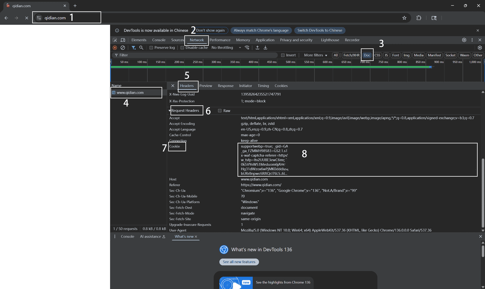

## Copy Cookies

### Method 1



(1) Open the target URL in a browser and navigate to the page whose cookies you need.

* Open the developer tools
* Press `F12`, or right-click an empty area of the page and choose "Inspect"

(2) Switch to the Network tab.

(3) In the toolbar, click **Doc** to filter for document requests.

(4) Find the request that matches the current page URL and click it.

* If you cannot find it, keep the developer tools open and reload the page (`F5` or `Ctrl + R`).

(5) Switch to the Headers panel on the right.

(6) Scroll down to the **Request Headers** section.

(7) Find the **Cookie** entry.

(8) Copy its full value.

---

### Method 2

If you only need the cookies of the currently logged-in user, you can copy them from the console without locating a request:

(1) Open a browser and log in to the target site.

(2) Press `F12` to open the developer tools.

(3) Switch to the Console tab.

(4) Paste the following code and press Enter:

```js
copy(document.cookie)
```

(5) The cookies are copied to the clipboard and can be pasted directly.

---

### Method 3 (recommended): use the built-in login window

For sites that require login (such as Fanqie Novel), you do not need to copy cookies manually. Let the downloader open a real browser window for login:

```bash
# Open the login window and save session cookies after a successful login
novel-cli login fanqienovel

# List sites that support interactive login
novel-cli login --list
```

The login window requires optional GUI components (they are not installed with the main program; the command reports a hint when they are missing). Once login is detected, cookies are written to `<cache dir>/<site>/aiohttp.cookies` and reused directly by later searches and downloads.