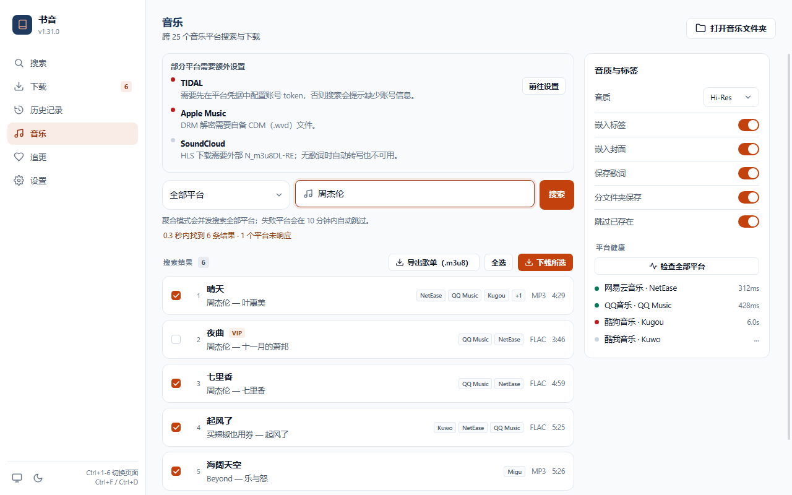

## Music Downloads

The music engine is optional and shares the same service layer as novel downloads. The CLI, desktop client, Android standalone mode and local API all use it, so the platform list, merge rules and on-disk behaviour are the same everywhere.

This page describes the engine's behaviour and limits. For parameters see [CLI Usage - music subcommand](./cli-examples.en.md#7-music-subcommand) and [Local API Service - Music](./api.en.md#music); for symptoms see [Troubleshooting](./troubleshooting.en.md).

> **The platform count is not fixed**: the registry is evaluated at import time against the optional dependencies that are actually installed, so a platform whose dependency is missing does not appear. Treat the output of `novel-cli music platforms` or `GET /api/v1/music/platforms` as authoritative.

The desktop Music tab combines platform notes, aggregated search, playlist export and the platform health check on one page:



---

### Installation and dependencies

The music engine is not part of the default install:

```bash
pip install "novel-downloader[music]"
```

Before every run the CLI probes for `mutagen`, `qrcode`, `websocket-client` and friends; if any is missing it prints the install hint above and exits non-zero instead of raising a traceback. The desktop installer and Android standalone build bundle these dependencies.

The `music` extra also carries the optional dependencies of the platform adapters:

| Dependency | Platforms affected |
| --- | --- |
| `aigpy` | TIDAL (the whole platform is not registered without it) |
| `ytmusicapi` | YouTube Music search |
| `pywidevine` | DRM modules for Apple Music / SoundCloud |
| `m3u8`, `emoji`, `bleach`, `filetype`, ... | Adapters for 5sing / Migu / Kuwo / Qianqian / Bilibili / JOOX import these at module load |

DRM decryption and HLS downloads additionally need **external** conditions (your own CDM, `N_m3u8DL-RE`) that are not pip dependencies; see "DRM and regional limits" below.

---

### Platform model

Every platform implements a common interface: `search` returns platform-neutral `Track` objects, `resolve` turns a `Track` into a downloadable direct link, and `lyric` returns original and translated lyrics when available. The registry stores only a display name and a constructor; platform implementations are imported when selected.

Platforms are grouped as `国内` (China), `国际` (International) and `曲库` (Catalog), sorted by display name inside each group. The CLI `--platform` option accepts a registry key (`netease`), a display name (`网易云音乐` or `国内 · 网易云音乐`), or a common alias (`163`, `NetEase`, `网易云`, ...), all case-insensitively; an unknown platform is a usage error (`2`) that lists the available keys. Some platforms have a usage note (`platform_note`), printed by the CLI after a platform is selected and shown under the search box in the desktop app:

| Platform | Note |
| --- | --- |
| TIDAL | Requires a token JSON in the platform credentials, otherwise search is empty |
| Soda Music | Requires a device Cookie (`{"cookies": {...}}`), otherwise it may hang for a long time |
| Apple Music | Requires an account; DRM decryption requires your own CDM (`.wvd`) |
| SoundCloud | Search works; DRM/HLS downloads require a CDM and external `N_m3u8DL-RE` |
| Spotify / YouTube | Downloads depend on third-party services, which may be unreachable |
| Qobuz / Deezer / Suno / MOOV / JOOX | Require direct access to the corresponding site; otherwise search is empty or times out |

Credential file locations are covered in "Data directory and security". Credentials are re-read on the next search; no process restart is needed.

---

### Unified search and source merging

`--platform` defaults to `all` for `search` and `download`: one query covers every registered platform instead of forcing a per-platform choice first. The desktop platform picker likewise puts "All platforms" first and selects it by default.

Aggregate search rules (implemented in `apps/music/aggregate.py`):

* **Concurrency**: a bounded thread pool queries the platforms and takes results as they arrive; a failure in one platform is recorded against that platform only.
* **Budget**: the whole search has a wall-clock limit (5 seconds by default for CLI/API, 6 seconds for the progressive desktop search). Once the first platform returns, the engine waits about 2 more seconds and then stops; platforms that have not answered are skipped for this run.
* **Per-platform count**: aggregate search takes a small number of raw results per platform (8 by default) and truncates the merged list to `--limit`.
* **Merging**: tracks with the same normalized "title + artist" are treated as one song (when the artist is unknown the album is used instead, so covers are not merged by accident). The merged row lists the matching platforms in `sources`, best source first.
* **Primary source**: non-VIP first, then a cover, a duration, an ID, and finally platform order. VIP tracks sort later so a merged row does not keep only an undownloadable source.
* **Ordering**: keyword relevance first, then non-VIP, number of sources, and platform order.

`sources` is not just display data: during a batch download, if the primary source fails the engine tries the other platforms for the same song in `sources` order (only for in-process original objects; a single-platform search has no alternatives).

Failures and circuit breaking:

* A platform that raises or exceeds the budget is recorded as failed and skipped by aggregate search for 10 minutes.
* A platform that twice takes over 2 seconds and returns nothing is treated as "slow and empty" and skipped for 5 minutes.
* This state is written to `search_stats.json` in the music data directory and survives a restart.
* **Explicitly selecting a platform bypasses the breaker**, which makes manual retries possible.
* If every platform fails, the CLI exits non-zero; zero results from platforms that answered normally is a successful empty search. For diagnosis see [Troubleshooting - aggregate music search](./troubleshooting.en.md#8-some-music-platforms-do-not-respond-are-very-slow-in-aggregate-search).

---

### `search_id`: giving downloads back the original search objects

Direct-link resolution data exists only inside the process (musicdl's `SongInfo`, NetEase raw fields). Once a search result has been through JSON — the pywebview bridge on desktop, HTTP for REST or the embedded engine — those objects degrade to plain dicts and `resolve` fails.

How the API handles it:

1. `POST /api/v1/music/search` returns a `search_id` alongside the tracks.
2. Send `search_id` back when downloading (`POST /api/v1/music/download` or `POST /api/v1/music/jobs`).
3. The server restores the original `Track` objects from the in-process cache by `search_id`; the submitted JSON copies are only a fallback when the cache misses.

Cache limits: at most 32 searches, 30 minutes each, LRU eviction, and the TTL starts when the search happens (a hit does not extend it). After a restart or expiry you must search again; the provider then reports a clear reason such as 「搜索结果已失效，请重新搜索后再下载」 (search results expired, search again) instead of raising `AttributeError`.

The CLI never goes through JSON, so it uses the original objects in the same process and does not need `search_id`. Playlist export does not need it either — export only cares about local file paths.

---

### Downloading and writing files

Quality levels are `hires` / `lossless` / `exhigh` / `higher` / `standard`; the default comes from the music settings, usually `exhigh`.

* NetEase requests the target level first, then falls back to `standard` once if no direct link is available. The level that actually worked is recorded in the result and may be lower than requested.
* Restricted tracks (VIP-only, album purchase required, no copyright / delisted, preview-only) produce a readable reason and count as failed or skipped; they do not abort the batch.
* Transport failures are retried automatically (2 times by default, not counting the first attempt). The `.part` file is kept during retries, which also provides resumption.
* A download is written to `<target>.part`, size-checked, then atomically renamed. An HTML/JSON error page returned by the server (expired direct link) is rejected, so a web page is never saved as audio.

#### Download size limits

One track and one batch each have a hard ceiling, so an expired direct link or a misbehaving CDN cannot stream forever:

| Scope | Default | Behaviour |
| --- | --- | --- |
| Single track | 1 GiB (`MAX_TRACK_BYTES`) | Checked chunk by chunk; an existing `.part` prefix counts toward the limit |
| Batch | 8 GiB (`MAX_BATCH_BYTES`) | Shared by every worker of one `download_many` / `download_mixed` call, including platform fallbacks |

* If the declared `Content-Length` / `Content-Range` total already exceeds the limit, the body is not read to the end; when the declaration is missing or wrong, the per-chunk check is the final guarantee.
* Track over the limit (or an existing `.part` already larger than the limit): the half file is deleted, no resumable point is left, and the attempt is not retried (a retry would hit the same ceiling).
* Batch over the limit: the download stops before the next chunk is written and the current track's half file is deleted. Tracks that already completed are unaffected and the rest of the batch continues.
* Transport failure or user cancellation: the `.part` is kept for resumption, but the bytes charged by that attempt are **returned** to the batch budget. The batch ceiling therefore bounds completed and in-flight downloads, not the total size of `.part` files on disk. Files skipped by `skip_existing` consume nothing.
* The reason appears in the per-track result and the batch summary, for example `单曲超过大小上限（1.0GB），已删除不完整文件` ("track exceeds the size limit, incomplete file deleted") or `整批下载超过大小上限（8.0GB），已删除不完整文件` ("batch exceeds the size limit, incomplete file deleted"). `human()` uses 1024-based units but labels them KB/MB/GB. These failures are deterministic and report `retryable` as `false`.

Adjusting the limits: the CLI, desktop client, Android standalone mode and REST API **do not expose** these fields and always use the defaults above. The music `settings.json` is not consulted for these keys either, so editing it has no effect. Only Python library callers can override them through `DownloadOptions`:

```python
from novel_downloader.apps.music.downloader import DownloadOptions

opts = DownloadOptions(
    out_dir="~/Music/novel_downloader",
    max_track_bytes=512 * 1024 * 1024,  # 512 MiB per track
    max_batch_bytes=2 * 1024**3,        # 2 GiB per batch
)
```

Both fields are byte counts; `None` keeps the default constant. An explicit value must be a positive integer: `0`, a negative number, a boolean or a non-integer raises `ValueError` when `DownloadOptions` is constructed (`...大小上限必须是正整数`).

File naming:

* With `split_folder` enabled: `<out_dir>/<artist>/<album>/<title> - <artist>.<ext>`; disabled: directly under `<out_dir>`.
* Same-title tracks with different IDs use `<title> - <artist> [<id>].<ext>` to avoid overwriting each other.
* `skip_existing` only skips an existing file larger than 10 KiB.
* Tags, cover and lyrics are best-effort: a failure in any of them skips that step only, and the downloaded audio still counts as successful.
* Lyrics are written next to the audio as `<stem>.lrc`; a translation is written as `<stem>.zh.lrc`, see "Lyric files" below. With `embed_lyric` on, the same text is also written into the audio tag, see "Embedded lyrics".

#### Lyric files (LRC)

Lyrics share the audio file's stem and directory. `save_lyric` is enabled by default (`"save_lyric": true` in the music settings). They are always written as **separate files** so players and external tools can each use what they need:

| Provider returns | Files written | Content |
| --- | --- | --- |
| Original only | `<stem>.lrc` | Original text (usually with `[mm:ss.xx]` timestamps) |
| Original + translation | `<stem>.lrc` / `<stem>.zh.lrc` | Original / translation |
| Translation only | `<stem>.lrc` | The translation (so a player never shows no lyrics at all) |
| Neither | no file | — |

`<stem>` is the audio file name without its extension, including the ` [<id>]` suffix added when two tracks would otherwise collide, so the lyrics always match the audio file next to them. Files are UTF-8 without a BOM, with newlines normalised to `\n` (some providers return CRLF, which many players cannot parse).

Write boundaries:

* If the content is byte-identical to the existing file, nothing is written and its mtime is left alone. Otherwise a temporary file in the same directory is written and atomically replaced; a failed replace never damages the previous lyrics.
* A response larger than 1 MiB is treated as an error page or full web page, not lyrics; it is skipped with a warning.
* Fetching or writing lyrics only logs a WARNING. The downloaded audio still counts as successful; lyrics never fail a track.
* When the audio already exists and `skip_existing` skips it, lyrics are backfilled only if `<stem>.lrc` is **missing**. Existing lyrics are neither re-fetched nor overwritten; when a backfill does run and a translation is available, `.zh.lrc` is written too.
* If the provider returns no lyrics, the engine falls back to lyric fields already carried by the search result object without another request; placeholders (`null`/`none`/`nil`) are not lyrics.
* Lyric files are plaintext like the audio and may contain copyrighted text; store them like any other download and do not commit them to a repository.

#### Embedded lyrics (`embed_lyric`)

`save_lyric` writes the standalone `.lrc`; `embed_lyric` controls whether the same text is also stored in the audio file's metadata. It is **off by default** and independent of `save_lyric`: with both on you get the `.lrc` and the embedded tag; with only `embed_lyric` on, the audio tag is updated and no sidecar is created.

Support is decided by container extension, and covers exactly three:

| Container | Tag written | Notes |
| --- | --- | --- |
| MP3 | ID3 `USLT` (unsynchronised lyrics) | Existing `USLT` frames and `TXXX:LYRICS` / `TXXX:UNSYNCEDLYRICS` are removed first; saved as ID3v2.3 |
| FLAC | Vorbis comment `LYRICS` | Only the Vorbis comment block changes; sample rate and format are preserved |
| M4A | MP4 atom `©lyr` | — |

Other containers (ogg/opus/wav, ...) are skipped silently: no error and no tag. Writing touches metadata only and never transcodes, so the audio stream, format and bitrate stay unchanged.

The text source matches `.lrc`: the original is preferred and the translation is used when it is the only one available; newlines are normalized to `\n` and surrounding whitespace is trimmed; empty lyrics and placeholders are not written. Lyrics over 1 MiB (`MAX_LYRIC_BYTES`, the same limit as `.lrc`) are not embedded, and text identical to what the tag already holds is not rewritten (the mtime is left alone).

MP3 gets **unsynchronised lyrics** (`USLT`) only; no `SYLT` frame is written. Players that parse only `SYLT` (per-line timing) will not see the embedded lyrics; they can still read the `.lrc` next to the audio, so keep `save_lyric` on when broad compatibility matters. The `.lrc` remains the portable representation; the embedded tag is for players that read the audio file alone.

Enabling it: `music download` in the CLI turns it on with `--embed-lyric` and off with `--no-embed-lyric`; with neither flag the music setting `embed_lyric` applies (off by default). The desktop client exposes the same switch under Settings → Music downloads and writes it to the same music settings immediately. The music `settings.json` accepts the boolean `"embed_lyric": true/false`; a non-boolean value falls back to the default (off). Android standalone mode and the REST API still do not expose the switch. Library callers use:

```python
from novel_downloader.apps.music.downloader import DownloadOptions

opts = DownloadOptions(
    out_dir="~/Music/novel_downloader",
    embed_lyric=True,   # False by default
)
```

When `skip_existing` skips an existing audio file, the embedded lyric is backfilled as follows:

* Only when the container is supported and the tag holds no lyrics yet. An existing embedded lyric is never touched: no network request and no byte changes.
* The `<stem>.lrc` next to the audio is read first (falling back to `.zh.lrc`) and written to the tag, without calling the lyric endpoint.
* Only when neither `.lrc` exists is the provider asked for lyrics; if `save_lyric` is also on, that same request also backfills the missing sidecar.

A failure in either the lyric fetch or the tag write only logs a WARNING; the downloaded audio still counts as successful, and a failed tag write never rolls back or damages the audio file.

Batch downloads:

* Aggregate results are grouped by `provider`; each platform is downloaded concurrently and progress is mapped back to the whole batch.
* When the primary source fails and alternatives exist, other platforms are tried in order. A successful fallback reports success once, not one failure plus one success.
* The CLI exits non-zero if any track failed, so scripts cannot mistake "a few files missing" for success.
* The API `out_dir` must stay inside the music output directories; absolute paths outside them, `..` components and symlink escapes are rejected, and the error never echoes the submitted path.

---

### Playlist export

`export-m3u` writes **already downloaded** tracks to an M3U8 playlist; it does not download audio or fetch direct links:

1. It searches again with `--keyword` (platform defaults to `netease`).
2. For each result it looks for `<title> - <artist>.<ext>` under `<out_dir>/<artist>/<album>/` using the downloader's naming convention; if that is missing it also tries the ` [<id>]` variant.
3. Only tracks with a local path are written; the rest are counted as skipped. If nothing matches, the command fails instead of writing an empty playlist.
4. The default output is `<out_dir>/<keyword>.m3u8`. The playlist is UTF-8 with `#EXTM3U` and `#EXTINF` entries, and stores paths relative to the playlist directory by default so the whole folder can be moved.

The API `POST /api/v1/music/export` does not search and requires every track to carry a local `path`. `out_path` must be a `.m3u` / `.m3u8` file (or a directory, in which case a timestamped `playlist-*.m3u8` is created) and must stay inside the allowed music directories; otherwise it returns `400` with the fixed detail `"Playlist out_path must be a .m3u/.m3u8 file inside the music output directory"`, without echoing the submitted path.

When exporting a playlist from the desktop Music tab, an existing target is never silently overwritten: the app first reports "The playlist already exists: <path>" and only replaces the file after you click that message.

For 400/429 export failures see [Troubleshooting - playlist export](./troubleshooting.en.md#12-music-playlist-export-returns-400-music-jobs-return-429).

---

### Platform health

A health check performs one **bounded search** only; it does not resolve direct links or download anything. It distinguishes "the platform is down" from "this song is not found".

* CLI: `novel-cli music health` checks every platform concurrently, or use `--platform KEY` for one. The probe keyword defaults to `test` and each platform returns at most one result. A successful search with zero results still counts as reachable (that is what an auth-required platform without credentials looks like). The command exits non-zero if any platform fails. With `--json` it prints one line, `{"keyword", "platforms": [{"platform", "ok", "elapsed_ms", "error"}], "failed"}`, whose field names match the REST endpoint (on failure the complete JSON is printed first, then the command exits `1`).
* API: `GET /api/v1/music/health` returns `platform`, `ok`, `elapsed_ms` and `error` per platform. Omitting `platform` checks all; `timeout` defaults to 5 seconds (must be greater than 0 and at most 60). An unknown platform returns `400`.
* A passing single-platform check only means "it can complete a search"; it does not mean member-only or DRM tracks are downloadable.

---

### DRM and regional limits

**Searchable does not mean downloadable.** These platforms try to resolve a downloadable direct link during search; when none is available the list may be empty or contain only previews.

| Platform | Limit |
| --- | --- |
| TIDAL | A token JSON must be configured in the platform credentials, otherwise search is empty; downloads work only when the platform returns an HTTP direct link |
| Apple Music | An account is required for full tracks; DRM decryption requires your own CDM (`.wvd`) |
| SoundCloud | Search works; DRM/HLS tracks require a CDM and external `N_m3u8DL-RE` |
| YouTube Music | Search uses `ytmusicapi`; downloads depend on a third-party resolution service |
| Spotify | Downloads depend on a third-party service, usually unreachable from this environment |

The built-in downloader accepts non-HLS direct links only: HLS (m3u8) resolution is rejected immediately with "HLS 流暂不支持直链下载". Even with a CDM and `N_m3u8DL-RE`, DRM/HLS tracks from Apple Music / SoundCloud therefore **cannot** be downloaded in-app; use an external tool that supports Widevine. This is an expected limit of the current version, not a network failure.

Full details and verification commands: [Troubleshooting - TIDAL / YouTube / Apple Music / SoundCloud](./troubleshooting.en.md#10-tidal-youtube-apple-music-soundcloud-searchable-does-not-mean-downloadable).

---

### Data directory and security

Music runtime data lives in the `music/` subdirectory of the platform data directory (`%LOCALAPPDATA%\novel_downloader\music\` on Windows) and can be relocated wholesale with `NOVEL_MUSIC_HOME`:

| File | Contents |
| --- | --- |
| `settings.json` | Output directory, quality, tags/cover/lyrics (including embedded lyrics via `embed_lyric`), split folders, skip existing, worker count |
| `session.json` | NetEase login state (browser cookies) |
| `platform_creds.json` | Per-platform credentials such as a TIDAL token or Soda cookie |
| `search_stats.json` | Aggregate-search failure breaker and "slow and empty" statistics |

The default download directory is `novel_downloader` under the user's music directory (for example `~/Music/novel_downloader`).

These files and cookies are stored in **plaintext**, and `session.json` / `platform_creds.json` can take over an account directly. Do not commit them, paste them into issues, or include them in screenshots. Delete the files and sign out on the platform side when switching machines or after a suspected leak. See [Security - where cookies and credentials are stored](./security.en.md#where-cookies-and-credentials-are-stored) for locations and permission advice.

---

### Related documentation

* [CLI Usage - music subcommand](./cli-examples.en.md#7-music-subcommand): full parameters and examples for the five subcommands
* [Local API Service - Music](./api.en.md#music): search, synchronous/asynchronous download, playlist export and health endpoints
* [Troubleshooting](./troubleshooting.en.md): missing dependencies, slow aggregate search, DRM limits, export 400/429
* [Android Client](./android-app.en.md): standalone mode bundles the music engine
