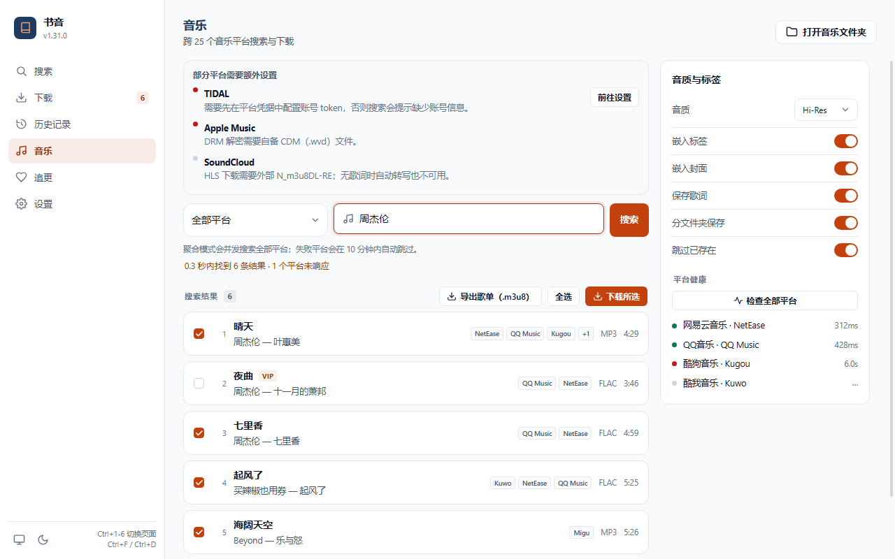

## 音乐下载

音乐功能是一个可选引擎, 与小说下载共用同一套服务层。CLI、桌面客户端、Android 独立模式与本地 API 都调用它, 因此平台列表、搜索合并规则和落盘行为在各端一致。

本文说明引擎的行为与边界。具体参数见 [CLI 用法 - music 子命令](./cli-examples.md#7-music) 与 [本地 API 服务 - 音乐](./api.md); 故障现象见 [故障排查](./troubleshooting.md)。

> **平台数量不是固定值**: 注册表在导入时按已安装的可选依赖求值, 缺依赖的平台不会出现在列表里。请以 `novel-cli music platforms` 或 `GET /api/v1/music/platforms` 的实际输出为准。

桌面端音乐页把平台提示、聚合搜索、歌单导出和平台健康检查放在同一页：



---

### 安装与依赖

音乐引擎不在默认安装中:

```bash
pip install "novel-downloader[music]"
```

CLI 在每次执行前先探测 `mutagen`、`qrcode`、`websocket-client` 等依赖; 缺失时打印上面这条安装提示并以非零状态退出, 不会抛出 traceback。桌面安装包与 Android 独立模式已内置这些依赖。

`music` 组同时包含平台适配器的可选依赖:

| 依赖 | 影响的平台 |
| --- | --- |
| `aigpy` | TIDAL (缺少时整个平台不注册) |
| `ytmusicapi` | YouTube Music 搜索 |
| `pywidevine` | Apple Music / SoundCloud 的 DRM 模块 |
| `m3u8`、`emoji`、`bleach`、`filetype` 等 | 5sing / 咪咕 / 酷我 / 千千 / 哔哩哔哩 / JOOX 等适配器在导入时直接引用 |

DRM 解密与 HLS 下载还需要**外部**条件 (自备 CDM、`N_m3u8DL-RE`), 不在 pip 依赖内, 见下方「DRM 与区域限制」。

---

### 平台模型

每个平台实现统一接口: `search` 返回平台无关的 `Track`, `resolve` 把 `Track` 解析成可下载直链, `lyric` 按需返回原文与译文。注册表只保存「显示名 + 构造器」, 平台实现在被选中时才导入。

平台按 `国内` / `国际` / `曲库` 分组展示, 组内按显示名排序。CLI 的 `--platform` 接受注册表 key (`netease`)、显示名 (`网易云音乐` 或 `国内 · 网易云音乐`) 与常见别名 (`163`、`NetEase`、`网易云` 等), 均不区分大小写; 未知平台以用法错误 (`2`) 退出并列出可用 key。部分平台带有使用提示 (`platform_note`), CLI 在选择平台后打印, 桌面端显示在搜索框下方:

| 平台 | 提示要点 |
| --- | --- |
| TIDAL | 必须在平台凭据中配置 token JSON, 否则搜索为空 |
| 汽水音乐 | 需配置设备 Cookie (`{"cookies": {...}}`), 否则可能长时间无响应 |
| Apple Music | 需账号; DRM 解密需要自备 CDM (`.wvd`) |
| SoundCloud | 搜索可用; DRM/HLS 下载需要 CDM 与外部 `N_m3u8DL-RE` |
| Spotify / YouTube | 下载依赖第三方服务, 当前网络可能不可达 |
| Qobuz / Deezer / Suno / MOOV / JOOX | 需要能直接访问对应站点, 不可达时搜索为空或超时 |

凭据文件的位置见「数据目录与安全」。修改凭据后重新搜索即可, 不需要重启进程。

---

### 统一搜索与来源合并

`search` 与 `download` 的 `--platform` 默认是 `all`: 一次查询所有已注册平台, 而不是要求用户先选平台。桌面端的平台下拉也把「全部平台」放在第一项并默认选中。

聚合搜索的规则 (实现见 `apps/music/aggregate.py`):

* **并发**: 有界线程池并发查询各平台, 先到先收; 单个平台异常只记为该平台失败, 不影响其它平台。
* **预算**: 整次搜索有墙钟上限 (CLI/API 默认 5 秒, 桌面渐进式搜索为 6 秒)。首个平台返回结果后, 再等约 2 秒就收工, 不回来的平台本次略过。
* **每平台条数**: 聚合时每个平台只取少量原始结果 (默认 8 条), 合并后再按 `--limit` 截断。
* **合并**: 规范化后的「歌名 + 歌手」相同即视为同一首 (歌手未知时退回专辑, 避免误合并翻唱)。合并后一行一首, `sources` 记录命中的平台, 最佳来源在前。
* **主来源选择**: 非会员优先, 其次有封面、有时长、有 ID, 最后才看平台顺序; 会员曲目整体排在后面, 避免合并后只留下一个下载不了的来源。
* **排序**: 关键词相关度优先, 其次非会员、来源数量、平台顺序。

聚合结果的 `sources` 不只是一份展示信息: 批量下载时主来源失败, 引擎会按 `sources` 顺序尝试同一首歌的其它平台 (仅限进程内的原始对象, 单平台搜索没有备选来源)。

失败与熔断:

* 抛异常或超出预算的平台记为失败, 并熔断 10 分钟; 期间聚合搜索跳过它。
* 连续两次耗时超过 2 秒且零结果的平台判为「慢且空」, 跳过 5 分钟。
* 这些状态写入音乐数据目录的 `search_stats.json`, 重启后仍生效。
* **显式指定平台时不走熔断**, 便于手动重试。
* 所有平台都失败时 CLI 以非零状态退出; 平台正常响应但零结果属于成功的空搜索。排查步骤见 [故障排查 - 音乐聚合搜索](./troubleshooting.md#8)。

---

### `search_id`: 让下载拿回原始搜索结果

音乐直链的解析数据只存在于进程内 (musicdl 的 `SongInfo`、网易云的原始字段)。搜索结果一旦经 JSON 往返——桌面端走 pywebview 桥, REST 或内嵌引擎走 HTTP——这些数据会退化成普通 dict, `resolve` 就会失败。

API 的处理方式:

1. `POST /api/v1/music/search` 在返回曲目的同时返回一个 `search_id`。
2. 下载时把 `search_id` 原样回传 (`POST /api/v1/music/download` 或 `POST /api/v1/music/jobs`)。
3. 服务端按 `search_id` 从进程内缓存取回原始 `Track` 对象; 回传的 JSON 副本只作为缓存缺失时的兜底。

缓存边界: 最多 32 份搜索结果, 每份保留 30 分钟, LRU 淘汰, 且 TTL 从搜索那一刻起算 (命中不会续期)。进程重启或过期后需要重新搜索; 此时平台会返回「搜索结果已失效, 请重新搜索后再下载」一类的明确原因, 而不是 `AttributeError`。

CLI 不经过 JSON 往返, 在同一个进程里直接使用原始对象, 因此不需要 `search_id`。歌单导出也不需要它——导出只认本地文件路径。

---

### 下载与落盘

音质档位为 `hires` / `lossless` / `exhigh` / `higher` / `standard`, 默认取音乐设置, 通常为 `exhigh`。

* 网易云会先请求目标档位, 拿不到直链时再用 `standard` 兜底一次; 实际命中的档位记录在结果里, 可能低于请求档位。
* 受限曲目 (VIP 专属、需购买专辑、无版权/已下架、仅试听片段) 返回可读原因并计为失败或跳过, 不会中断整批任务。
* 传输类失败自动重试 (默认 2 次, 不含首次), 重试期间保留 `.part` 文件, 因此兼作续传。
* 下载先写 `<目标文件>.part`, 校验大小后再原子改名; 服务端返回 HTML/JSON 错误页 (直链过期) 会被拒绝, 不会把网页当音频保存。

落盘命名:

* `split_folder` 开启时: `<out_dir>/<歌手>/<专辑>/<歌名> - <歌手>.<ext>`; 关闭时直接放在 `<out_dir>`。
* 同名但不同 ID 的曲目用 `<歌名> - <歌手> [<id>].<ext>` 避免互相覆盖。
* `skip_existing` 只跳过已存在且大于 10 KiB 的同名文件。
* 标签、封面、歌词都是附加步骤: 任一失败只跳过该步骤, 已下载的音频仍算成功。
* 歌词写成音频旁的 `<stem>.lrc`; 有译文时另写 `<stem>.zh.lrc`, 详见下方「歌词文件」。

#### 歌词文件 (LRC)

歌词与音频同名、同目录, `save_lyric` 默认开启 (音乐设置 `"save_lyric": true`)。落盘规则固定为**独立文件**, 便于播放器和外部工具各取所需:

| 平台返回 | 写出的文件 | 内容 |
| --- | --- | --- |
| 只有原文 | `<stem>.lrc` | 原文 (通常带 `[mm:ss.xx]` 时间轴) |
| 原文 + 译文 | `<stem>.lrc` / `<stem>.zh.lrc` | 原文 / 译文 |
| 只有译文 | `<stem>.lrc` | 译文 (避免播放器完全看不到歌词) |
| 都没有 | 不创建文件 | — |

`<stem>` 是音频文件名去掉扩展名, 包含同名去重时追加的 ` [<id>]`, 因此歌词始终与它旁边那个音频文件对应。文件为 UTF-8 (无 BOM), 换行统一为 `\n` (部分来源返回 CRLF, 很多播放器解析不了)。

写入边界:

* 内容与现有文件完全一致时直接跳过, **不改 mtime**; 内容不同才先写同目录临时文件、再原子替换, 替换失败不会破坏旧歌词。
* 超过 1 MiB 的响应视为错误页/完整网页, 不落盘并记 WARNING。
* 获取歌词或写盘失败都只记 WARNING, 已下载的音频仍算成功, 不会因为歌词把整首歌判为失败。
* 音频已存在且被 `skip_existing` 跳过时, 只有 `<stem>.lrc` **不存在**才补写歌词; 已有歌词不联网、不覆盖。补写时若拿到译文, 同样会写 `.zh.lrc`。
* provider 没返回歌词时, 回退读取搜索结果对象自带的歌词字段, 不额外发起请求; 占位值 (`null`/`none`/`nil`) 不算歌词。
* 歌词与音频一样是明文文件, 可能包含版权内容; 按普通下载文件保管, 不要提交到仓库。

批量下载:

* 聚合搜索结果按 `provider` 分组, 每个平台内部并发, 进度折算到整批。
* 主来源失败且有备选来源时, 依次尝试其它平台; 回退成功只上报一次成功, 不会同时记一条失败。
* CLI 在任意一首失败时以非零状态退出, 避免脚本把「少了几个文件」当成成功。
* API 的 `out_dir` 只能落在音乐输出目录内; 绝对路径越界、含 `..` 或经软链接逃逸都会被拒绝, 且错误信息不回显提交的路径。

---

### 歌单导出

`export-m3u` 把**已经下载到本地**的曲目写成 M3U8 歌单, 不下载音频、不发网络请求去取直链:

1. 用 `--keyword` 重新搜索一次 (默认平台 `netease`)。
2. 对每条结果, 按下载器的命名约定在 `<out_dir>/<歌手>/<专辑>/` 下查找 `<歌名> - <歌手>.<ext>`; 找不到时再找 ` [<id>]` 后缀的版本。
3. 只有带本地路径的曲目写入歌单; 其余计入跳过。一首都没匹配到时命令失败, 不写空歌单。
4. 默认输出 `<out_dir>/<关键词>.m3u8`; 歌单为 UTF-8, 含 `#EXTM3U` 与 `#EXTINF`。默认写相对歌单目录的路径, 便于整个目录搬家。

API 的 `POST /api/v1/music/export` 不做搜索, 要求每首曲目自带本地 `path`。`out_path` 必须是 `.m3u` / `.m3u8` 文件 (或一个目录, 此时生成带时间戳的 `playlist-*.m3u8`), 并且必须落在允许的音乐目录内; 否则返回 `400`, `detail` 固定为 `"Playlist out_path must be a .m3u/.m3u8 file inside the music output directory"`, 不回显提交的路径。

桌面端音乐页导出歌单时, 目标文件已存在不会静默覆盖: 先提示「歌单已存在: <路径>」, 点击该提示后才替换。

导出链路的 400/429 排查见 [故障排查 - 音乐歌单导出](./troubleshooting.md#12-400-429)。

---

### 平台健康

健康检查只做一次**有界搜索**, 不解析直链、不下载, 用来区分「平台挂了」和「这首搜不到」。

* CLI: `novel-cli music health` 并发检查全部平台, 也可用 `--platform KEY` 只查一个; 探测关键词默认 `test`, 每平台只取 1 条结果。搜索成功但零结果也算连通 (未配置凭据的鉴权型平台就是空结果)。任一平台失败时命令以非零状态退出。加 `--json` 输出单行 `{"keyword", "platforms": [{"platform", "ok", "elapsed_ms", "error"}], "failed"}`, 字段名与 REST 端点一致 (失败时先输出完整 JSON, 再以 `1` 退出)。
* API: `GET /api/v1/music/health` 返回每个平台的 `platform`、`ok`、`elapsed_ms`、`error`; `platform` 省略时检查全部, `timeout` 默认 5 秒 (必须大于 0 且不超过 60 秒)。未知平台返回 `400`。
* 单平台检查通过只代表「能完成一次搜索」, 不代表该平台的会员曲目或 DRM 曲目能下载。

---

### DRM 与区域限制

**能搜到不等于能下载。** 这些平台在搜索阶段就会尝试解析可下载直链; 拿不到时列表可能为空, 或只剩试听片段。

| 平台 | 限制 |
| --- | --- |
| TIDAL | 必须在平台凭据里配置 token JSON, 否则搜索为空; 只有平台返回 HTTP 直链时才能下载 |
| Apple Music | 需账号才能拿到完整曲目; DRM 解密需要自备 CDM (`.wvd`) |
| SoundCloud | 搜索可用; DRM/HLS 曲目需要 CDM 与外部 `N_m3u8DL-RE` |
| YouTube Music | 搜索走 `ytmusicapi`; 下载依赖第三方解析服务 |
| Spotify | 下载依赖第三方服务, 当前环境通常不可达 |

内置下载器只接受非 HLS 的直链: 解析时遇到 HLS (m3u8) 会直接返回「HLS 流暂不支持直链下载」。因此即使准备了 CDM 与 `N_m3u8DL-RE`, Apple Music / SoundCloud 的 DRM/HLS 曲目也**不能**在应用内下载, 需要使用支持 Widevine 的外部工具。这不是网络故障, 属于当前版本的预期限制。

完整说明与验证命令见 [故障排查 - TIDAL / YouTube / Apple Music / SoundCloud](./troubleshooting.md#10-tidal-youtube-apple-music-soundcloud)。

---

### 数据目录与安全

音乐运行数据默认位于平台数据目录下的 `music/` 子目录 (Windows 为 `%LOCALAPPDATA%\novel_downloader\music\`), 可用 `NOVEL_MUSIC_HOME` 整体替换:

| 文件 | 内容 |
| --- | --- |
| `settings.json` | 输出目录、音质、标签/封面/歌词、分文件夹、跳过已存在、并发数 |
| `session.json` | 网易云登录态 (浏览器 Cookie) |
| `platform_creds.json` | 各平台的账号凭据, 如 TIDAL token、汽水 Cookie |
| `search_stats.json` | 聚合搜索的失败熔断与「慢且空」统计 |

默认下载目录是用户音乐目录下的 `novel_downloader` (例如 `~/Music/novel_downloader`)。

这些文件与 Cookie 均为**明文**, 且 `session.json` / `platform_creds.json` 可以直接接管账号。不要提交到仓库、粘贴到 issue 或截图里; 换机或怀疑泄露时删除对应文件并在平台侧注销会话。存储位置与权限建议见 [安全说明 - Cookie 与凭据的存储位置](./security.md#cookie)。

---

### 相关文档

* [CLI 用法 - music 子命令](./cli-examples.md#7-music): 五个子命令的完整参数与示例
* [本地 API 服务 - 音乐](./api.md): 搜索、同步/异步下载、歌单导出、健康检查端点
* [故障排查](./troubleshooting.md): 缺少依赖、聚合搜索很慢、DRM 限制、导出 400/429
* [Android 客户端](./android-app.md): 独立模式内置音乐引擎
