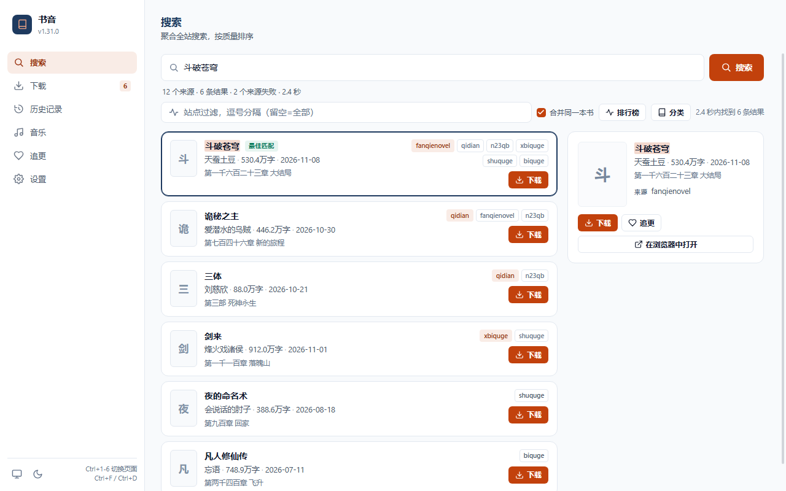
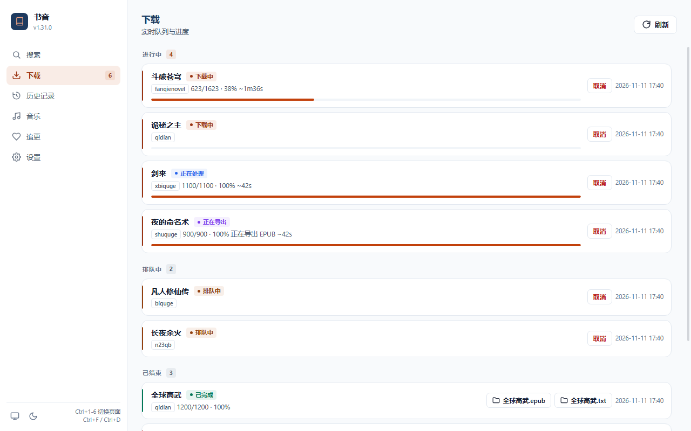

## 常见任务配方

本页给出可以直接复制执行的常见任务配方。所有命令都假设 `novel-cli` 已在 `PATH` 中；可用 `where novel-cli` (Windows) 或 `which novel-cli` 确认。

配置查找顺序为 `--config` 指定文件 → 当前目录 `settings.toml` / `settings.json` → 应用主目录 (`NOVEL_HOME` 或平台数据目录)。**计划任务/脚本一定要先 `cd` 到配置所在目录**，或使用接受 `--config` 的命令，否则会读到另一份配置。

---

### 1. 批量下载书单

#### 用 `batch` 按书名批量搜索并下载（推荐）

如果手上只有书名和作者（没有站点书籍 ID），用 `batch` 最省事。`books.txt` 每行 `标题 作者`：

```text
斗破苍穹 天蚕土豆
诡秘之主 爱潜水的乌贼
```

```bash
# 先试运行，确认匹配结果
novel-cli batch --file books.txt

# 确认无误后下载
novel-cli batch --file books.txt --download

# 只在一个站点搜索；两次搜索之间等待 1.5 秒
novel-cli batch --file books.txt --site b520 --download --interval 1.5
```

未匹配或格式错误的行会写进 `logs/not_found_<site>.txt`，可直接用它换源重试：

```bash
novel-cli batch --from-not-found logs/not_found_b520.txt --site biquge5r --download
```

标题本身含空格时用 Tab 分隔标题与作者。完整的输入格式、匹配规则与退出码见 [CLI 使用示例](./cli-examples.md)。

#### 同一站点、多个书籍 ID

`download --site` 接受多个书籍 ID：

```bash
novel-cli download --site b520 8_8187 12345 23456
```

> `--start` / `--end` 只作用于**第一个** `book_id`。需要给每本书指定范围时，请分多条命令执行，或使用配置文件中的结构化 `book_ids`。

#### 通过配置文件维护书单（备选）

```toml
# settings.toml
[sites.b520]
book_ids = ["8_8187", "12345", "23456"]

[sites.qidian]
book_ids = ["1010868264"]
```

```bash
# 省略 book_ids 时从配置文件读取
novel-cli download --site b520
novel-cli download --site qidian
```

#### 跨站点批量执行

Git Bash:

```bash
for site in b520 qidian n23qb; do
  novel-cli download --site "$site" || exit 1
done
```

Windows `cmd.exe`:

```bat
for %s in (b520 qidian n23qb) do novel-cli download --site %s
```

PowerShell:

```powershell
foreach ($site in 'b520', 'qidian', 'n23qb') {
    novel-cli download --site $site
    if ($LASTEXITCODE -ne 0) { exit $LASTEXITCODE }
}
```

#### 从 URL 列表逐行下载

URL 模式下一次只接受**一个** URL，因此用循环：

```bash
# books.txt 每行一个书籍 URL，空行会被跳过
while IFS= read -r url; do
  [ -z "$url" ] && continue
  novel-cli download "$url" || exit 1
done < books.txt
```

PowerShell:

```powershell
Get-Content .\books.txt | Where-Object { $_.Trim() } | ForEach-Object {
    novel-cli download $_
    if ($LASTEXITCODE -ne 0) { exit $LASTEXITCODE }
}
```

---

### 2. 只导出，不下载

`export` 只读取已经存在的原始数据 (`general.raw_data_dir`)，不会访问网络；书籍必须先下载过。

```bash
# 把已下载的书导出为 EPUB
novel-cli export --site b520 12345 --format epub

# 同时导出 TXT 和 EPUB
novel-cli export --site b520 12345 --format txt epub

# 从原始阶段导出（跳过 cleaner 处理）
novel-cli export --site b520 12345 --format epub --stage raw
```

* `--site` 和 `book_ids` 都给出时不会进入交互式选择，适合脚本。
* 输出目录为 `general.output_dir`（默认 `./downloads`）。
* `--start` / `--end` 仍然只作用于第一本书。
* 如果没有对应的原始数据，命令以退出码 `1` 结束。
* EPUB 会写入标准可访问性元数据（`schema:accessMode=textual`、`schema:accessibilityHazard=none`、`schema:accessibilitySummary`，有章节时加 `structuralNavigation`），阅读器与无障碍工具可直接识别；整书、分卷、单章导出一致。

省略 `--site` 或 `book_ids` 时会进入交互模式；非交互环境请显式提供两者。

---

### 3. 定时追更（Windows 计划任务）

思路：先用 `follow` 维护书单，再让计划任务定期执行 `follow check` 并写日志。

#### 第一步：加入追更列表

```bat
novel-cli follow add b520 8_8187 --title "示例小说"
novel-cli follow add qidian 1010868264 --title "另一本书"
novel-cli follow list
```

`--title` 很重要：`follow check` 会用它到站点搜索最新章节。省略标题时只能拿书籍 ID 当关键字，命中率低。

#### 第二步：创建批处理脚本

新建 `C:\novel\follow-check.cmd`（路径不要带空格）：

```bat
@echo off
setlocal
cd /d "C:\novel"

rem 用 where novel-cli 查到的实际路径替换下面这一行
set "CLI=C:\Users\me\AppData\Local\Programs\Python\Python312\Scripts\novel-cli.exe"
set "LOG=C:\novel\follow.log"

echo [%DATE% %TIME%] follow check >> "%LOG%"
"%CLI%" follow check --all >> "%LOG%" 2>&1

rem 可选：断点续传式更新指定书籍，只抓取缺失/新章节
"%CLI%" download --site b520 8_8187 >> "%LOG%" 2>&1

rem 或者：让 CLI 自动逐本下载有新章节的书并等待完成
rem "%CLI%" follow check --download --wait --wait-timeout 1800 >> "%LOG%" 2>&1

exit /b %ERRORLEVEL%
```

注意：

* `cd /d "C:\novel"` 让 `settings.toml`、`downloads`、`raw_data`、`logs` 都解析到预期位置。
* `follow check --download` 默认只**打印**下载命令，不会自行下载。需要自动更新时，可以像上面那样显式写 `download` 命令，也可以在计划任务里改用 `follow check --download --wait`：CLI 会把有新章节的书逐本排队下载并等待完成。`--wait-timeout`（默认 1800 秒）限定每本的等待上限，超时的任务会被取消并在汇总中计为「已取消」，不影响后续书籍。
* `follow check` 只要有任意一本书检查失败就以退出码 `1` 结束，但脚本会继续执行后面的下载命令；使用 `--wait` 时，只要有下载未成功完成（失败/取消/超时），退出码同样是 `1`。最终退出码可在 `follow.log` 中看到。

#### 第三步：注册计划任务

在**管理员**命令提示符中执行：

```bat
schtasks /Create /TN "NovelFollowCheck" /SC DAILY /ST 08:00 /TR "C:\novel\follow-check.cmd" /F
```

每 6 小时执行一次：

```bat
schtasks /Create /TN "NovelFollowCheck" /SC HOURLY /MO 6 /TR "C:\novel\follow-check.cmd" /F
```

立即运行一次、查看状态或删除任务：

```bat
schtasks /Run /TN "NovelFollowCheck"
schtasks /Query /TN "NovelFollowCheck" /V /FO LIST
schtasks /Delete /TN "NovelFollowCheck" /F
```

> 默认计划任务只在用户登录时运行。需要“无论用户是否登录都运行”时，在“任务计划程序”图形界面中修改该任务的常规选项并保存凭据。
>
> 运行结果写入 `C:\novel\follow.log`；计划任务本身不会弹出窗口。

---

### 4. 桌面端一键追更

不想配置计划任务时, 可用桌面客户端 (`novel-desktop`) 手动追更。追更列表与 `novel-cli follow` 共用同一份 `watchlist.json`, 两边添加的条目互通。



1. 启动 `novel-desktop`, 在「搜索」页签搜到书籍后选中并点「追更」; 也可在「追更」页签点「添加」, 手动录入站点与书籍 ID (建议同时填写标题, 供检查更新时搜索)。
2. 在「追更」页签点「检查更新」, 桌面端会逐本搜索最新章节并刷新列表。
3. 发现新章节后, 选中条目点「下载所选」加入下载队列; 未选中任何条目时会下载全部追更书籍。下载进度与导出文件分别在「下载」「历史」页签查看。



> 桌面端的音乐页签另有「检查平台」健康检查, 可一键探测各音乐平台是否可用。

---

### 5. Android 连接电脑

Android 客户端通过本地 REST API 访问电脑端，电脑与手机必须在同一局域网。

#### 第一步：启动 API 并监听局域网

```bash
novel-api --host 0.0.0.0 --port 8081 --token "change-me"
```

> `--host 0.0.0.0` 会监听所有网卡。未设置 token 时，同一局域网内任何人都能访问导出目录，请务必设置 token。

#### 第二步：放行防火墙端口

以管理员身份打开命令提示符：

```bat
netsh advfirewall firewall add rule name="Novel API 8081" dir=in action=allow protocol=TCP localport=8081
```

删除规则：

```bat
netsh advfirewall firewall delete rule name="Novel API 8081"
```

#### 第三步：查找电脑的局域网 IP

```bat
ipconfig
```

在输出中找到当前网卡的 `IPv4 地址`（例如 `192.168.1.23`）。也可用 PowerShell：

```powershell
Get-NetIPAddress -AddressFamily IPv4 |
  Where-Object { $_.IPAddress -notlike '127.*' } |
  Select-Object InterfaceAlias, IPAddress
```

#### 第四步：在 App 中填写地址

在 App 右上角“设置”中填写：

| 场景 | API 地址 |
| --- | --- |
| 模拟器访问电脑 | `http://10.0.2.2:8081/` |
| 真机访问电脑 | `http://192.168.1.23:8081/` |

如果启动 API 时设置了 token，把同一个值填入“API 密钥”。

#### 第五步：验证

在电脑本机（带上启动时设置的 token）：

```bash
curl -H "X-API-Key: change-me" http://127.0.0.1:8081/api/v1/health
```

在手机自带浏览器中打开 `http://192.168.1.23:8081/api/v1/health`。由于绑定的是非回环地址，`/docs` 会被自动关闭；返回 `401`（`Invalid or missing API token...`）就说明端口已连通且鉴权生效。

#### 可选：自定义下载目录（SAF）

App 的「设置 → 下载」可以点「选择目录」，通过系统文件选择器（SAF）指定历史页导出文件的保存位置；文件写入所选目录下的 `NovelDL/` 子目录，同名文件按 `name (1).ext` 去重。授权会持久化，重启后仍有效。

如果系统撤销了权限、目录被删除或换了设备，设置页会显示「自定义下载目录不可用」，下载会**自动回退到系统 Downloads** 并提示，不会写到错误位置。重新选择目录或点「恢复默认」即可。排查步骤见 [故障排查 - 自定义下载目录](./troubleshooting.md#51-saf)。

---

### 6. 用 API 集成到自己的程序

API 依赖可选组 `api`：

```bash
pip install "novel-downloader[api]"
novel-api --port 8081 --token "my-secret"
```

未设置 token 时可省略下面的 `Authorization` 请求头（仅建议在 `127.0.0.1` 上这样做）。

#### 搜索 → 建任务 → 轮询 → 取文件（curl）

```bash
BASE=http://127.0.0.1:8081
TOKEN=my-secret
AUTH="Authorization: Bearer $TOKEN"

# 1. 搜索
curl -s -X POST "$BASE/api/v1/search" \
  -H "$AUTH" -H "Content-Type: application/json" \
  -d '{"keyword":"斗破苍穹","sites":["qidian"],"per_site_limit":5}'

# 2. 新增下载任务（响应里有 task_id）
curl -s -X POST "$BASE/api/v1/tasks" \
  -H "$AUTH" -H "Content-Type: application/json" \
  -d '{"title":"斗破苍穹","site":"qidian","book_id":"123456"}'

# 3. 查询任务列表或单个任务
curl -s "$BASE/api/v1/tasks" -H "$AUTH"
curl -s "$BASE/api/v1/tasks/<task_id>" -H "$AUTH"

# 4. 列出导出文件并下载
curl -s "$BASE/api/v1/history" -H "$AUTH"
curl -OJ "$BASE/downloads/斗破苍穹.txt"
```

#### Python 示例（轮询到任务结束）

```python
import time

import requests

BASE = "http://127.0.0.1:8081"
HEADERS = {"Authorization": "Bearer my-secret"}

# 搜索并选第一条结果
resp = requests.post(
    f"{BASE}/api/v1/search",
    headers=HEADERS,
    json={"keyword": "斗破苍穹", "sites": ["qidian"], "per_site_limit": 5},
    timeout=30,
)
resp.raise_for_status()
best = resp.json()["results"][0]

# 入队
resp = requests.post(
    f"{BASE}/api/v1/tasks",
    headers=HEADERS,
    json={"title": best["title"], "site": best["site"], "book_id": best["book_id"]},
    timeout=30,
)
resp.raise_for_status()
task_id = resp.json()["task_id"]

# 轮询
while True:
    snapshot = requests.get(f"{BASE}/api/v1/tasks", headers=HEADERS, timeout=30).json()
    tasks = snapshot["pending"] + snapshot["running"] + snapshot["completed"]
    task = next((item for item in tasks if item["task_id"] == task_id), None)
    if task is None:
        raise RuntimeError("task disappeared")
    if task["status"] in {"completed", "failed", "cancelled"}:
        break
    time.sleep(2)

print(task["status"], task["progress"], task["exported_paths"])
```

任务对象字段：`task_id`、`title`、`site`、`book_id`、`status`、`chapters_done`、`chapters_total`、`progress`、`error`、`exported_paths`、`created_at`、`finished_at`。`status` 取值包括 `queued`、`running`、`processing`、`exporting`、`completed`、`cancelled`、`failed`。

#### 追更接口

```bash
# 加入追更列表
curl -s -X POST "$BASE/api/v1/watchlist" \
  -H "$AUTH" -H "Content-Type: application/json" \
  -d '{"site":"b520","book_id":"8_8187","title":"示例小说"}'

# 检查新章节；download=true 时对有更新的条目返回可直接 POST 到 /tasks 的 task 请求体
curl -s -X POST "$BASE/api/v1/watchlist/check" \
  -H "$AUTH" -H "Content-Type: application/json" \
  -d '{"download":true}'
```

* `GET /api/v1/watchlist` 列出全部追更条目。
* `DELETE /api/v1/watchlist/{site}/{book_id}` 移除条目。
* `/watchlist/check` 只检查、不下载；`needs_download` 中的条目带有 `task` 字段，由调用方自行提交。
* 需要实时进度时可用 SSE：`GET /api/v1/tasks/stream`；搜索流为 `GET /api/v1/search/stream`。SSE 需要自定义请求头，请用支持设置请求头的客户端。

`/downloads/*` 与 `/api/v1/*` 一样受 token 保护（设置 token 时需带同样的请求头）；对外暴露 API 时仍建议配合防火墙限制来源。

---

### 7. 定期备份章节数据库并自动轮转

思路：把 `storage backup` 放进计划任务，用 `--keep` 控制保留份数，避免备份目录无限增长。

```bash
# 先预览 --keep 会删哪些旧备份（零删除，新备份仍会写入）
novel-cli storage backup --out ~/novel-backups --keep 7 --dry-run

# 备份 + 每本书、每个 stage 只保留最新 7 份
novel-cli storage backup --out ~/novel-backups --keep 7

# 只读校验当前 raw_data (不修改文件), 有问题时退出 1
novel-cli storage verify

# 需要机器可读报告时
novel-cli storage backup --out ~/novel-backups --keep 7 --json
```

放进 Windows 计划任务（每天 03:00）：

```bat
schtasks /Create /TN "NovelBackup" /SC DAILY /ST 03:00 /TR "novel-cli storage backup --out C:\novel-backups --keep 7" /F
```

注意事项：

* `--keep` 只删除 `--out` 下严格匹配 `chapter.<stage>.<UTC 时间戳>.sqlite` 的普通文件；手工改名、旧版本留下的文件、目录和符号链接都不会被删。
* 本次运行刚写出的备份永远受保护；`--keep 0` 关闭清理。
* 删除失败时命令以 `1` 退出，但已完成的备份保留，便于计划任务报警。
* 备份是**明文**完整快照，可能含付费/私密正文；放在受控目录，不要提交 Git 或公开网盘。它不含 Cookie/token、配置、日志或媒体。
* 先跑一次 `novel-cli doctor --fix --dry-run`（再 `--fix`）可确保输出/缓存/日志目录存在并清掉过期 `.tmp`/`.part`，不影响备份文件。

---

### 8. 用搜索过滤缩小结果

按字数、更新时间筛选搜索结果，适合挑长篇或近期更新的书：

```bash
# 30 万字以上、100 万字以下
novel-cli search 斗破苍穹 --min-words 300000 --max-words 1000000

# 2024-01-01 当天及之后更新
novel-cli search 斗破苍穹 --updated-after 2024-01-01

# 过滤 + 跨站合并 + 单行 JSON，交给脚本处理
novel-cli search 斗破苍穹 --min-words 300000 --group --json | jq '.[0]'
```

要点：

* 字数是**按本**的数值，上下界都含边界；站点没返回 `word_count` 或无法解析的行会被丢弃。
* `--updated-after` 是含当天的下界，必须严格写成 `YYYY-MM-DD`；没有更新日期的行会被丢弃。
* 过滤在排序之后、`--group` 合并与 `--limit` 截断之前执行，只缩小结果集，不改变排序；不同过滤组合分别缓存，不会复用未过滤的快照。
* API 侧对应 `min_words` / `max_words` / `updated_after`，流式端点同名查询参数，语义一致。

#### 桌面端记住上次筛选

桌面端会保存最近一次**有效**的筛选条件，不必每次重新填写：

* 每次点击「搜索」且筛选通过校验时，当前的 `min_words` / `max_words` / `updated_after` 会写入桌面偏好文件（`desktop_prefs.json`）的 `search_filters` 键。三项都留空也是一种有效状态：点击搜索会清掉已保存的条件。
* 下次启动桌面端时，有保存值的字段会填回搜索页的筛选面板，面板也会自动展开，但**不会自动发起搜索**；查询词和搜索时机仍由你决定。
* 只改输入框而不点「搜索」不会覆盖已保存的值；「清除筛选」会立即清除保存的副本。
* 设置页「搜索筛选」一栏的「清除已保存的筛选」可单独删除这份记录，不影响当前页面里的输入。
* 偏好文件被手工修改或由旧版本写入时，非法字段会被**逐个忽略**（例如最低字数大于最高字数时两个字数条件都丢弃，非法日期只丢日期），启动时不会报错。

---

### 9. 常见问题 (FAQ)

**`novel-cli: command not found` / `'novel-cli' 不是内部或外部命令`**

```bash
where novel-cli
```

若没有输出，找到 Python 的 `Scripts` 目录（例如 `C:\Users\me\AppData\Local\Programs\Python\Python312\Scripts`）并加入 `PATH`，或直接用绝对路径调用 `novel-cli.exe`。

**计划任务运行了但没有效果**

检查 `follow.log`；确认脚本里有 `cd /d` 到配置目录、`CLI` 使用的是 `where novel-cli` 得到的绝对路径，并在“任务计划程序”中查看“上次运行结果”。

**`follow check` 总是找不到书籍**

给条目补上 `--title`：

```bash
novel-cli follow add b520 8_8187 --title "准确书名"
```

需要登录的站点先执行 `novel-cli login <site>`。

**配置加载时提示 `cookie` 或 `use_truncation` 告警**

参见 [配置说明](./configuration.md) 的“旧配置迁移”和 [设置项参考](./settings-reference.md)。`cookie` 应改为 `cookies`，`use_truncation` 应移到 `[sites.<site>.parser]`。

**频繁出现 403 / 503**

降低 `general.max_rps`、增大 `general.request_interval`，或切换 HTTP 后端。详见 [设置项参考](./settings-reference.md)。

**导出文件在哪里**

默认是运行目录下的 `./downloads`，可通过 `general.output_dir` 修改；`novel-cli storage` 会显示实际路径。